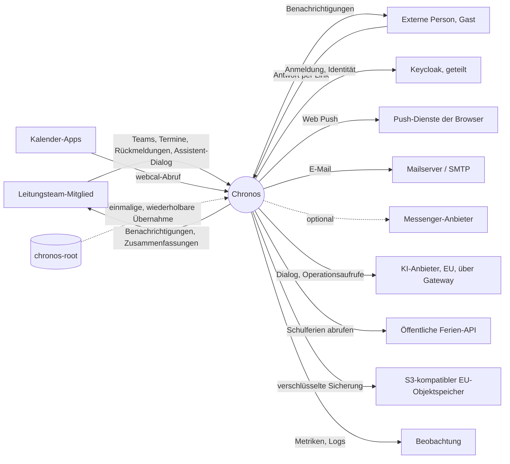

# 3.1 Fachlicher Kontext

Grundlage ist [SC-001](../../req42/03-scope/SC-001-systemkontext.md), ergänzt um zwei Nachbarn, die in req42 an anderer Stelle vorkommen, aber im Kontextdiagramm fehlen (Vorschlag zur Ergänzung: [wiki/proposals](../../../wiki/proposals/2026-11-20-sc-001-kontext-ergaenzen.md)).

| Nachbar | Fachliche Information | Richtung |
|---|---|---|
| Leitungsteam-Mitglied | Teams, Termine, Veranstaltungen, Rückmeldungen, Labels, Nachrichten, Assistent-Dialog | beide |
| Externe Person (Gast) | Name, Antwort; sieht nur, wofür der Link gilt | beide |
| Keycloak | Anmeldung, Kennung, Anzeigename, E-Mail | Chronos ← Keycloak |
| Push-Dienste, Mailserver, Messenger | Benachrichtigungen | Chronos → |
| KI-Anbieter | Gesprächsinhalte und Operationsaufrufe; enthält personenbezogene Daten ([RA-010](../../req42/12-risiken-annahmen/RA-010-ki-assistent-risiken.md)); anbieterneutral über ein KI-Gateway, nur EU-Datenstandort ([ADR-006](../09-entscheidungen/ADR-006-ki-anbindung.md)) | beide |
| Ferien-API | Schulferienzeiträume, mit Cache ([RA-008](../../req42/12-risiken-annahmen/RA-008-offene-fragen.md)) | Chronos ← |
| Kalender-Apps | iCalendar-Daten des persönlichen Feeds | Chronos → |
| Backup-Speicher | verschlüsselte Datenbankabzüge | Chronos → |
| Beobachtung | Metriken und Logs | Chronos → |
| chronos-root | Bestandsdaten | Chronos ← |

**Nicht im Kontext:** Kinder und Eltern ([SC-002](../../req42/03-scope/SC-002-im-und-nicht-im-scope.md)), Freundschaften, eigene Passwortverwaltung.
