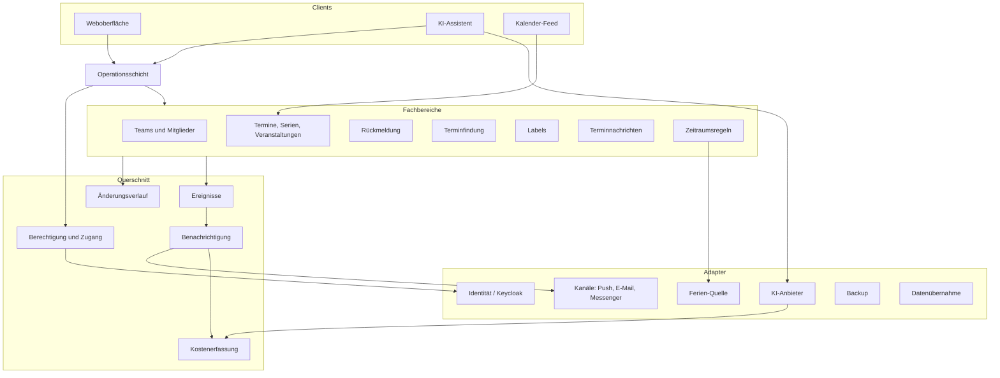

# Kapitel 5: Bausteinsicht

> **Stand: fachliche Kandidaten.** Die Bausteine ergeben sich aus dem Fachmodell und den Features. **Festgelegt ist die Prozessgrenze ([ADR-002](../09-entscheidungen/ADR-002-zerlegung-monolith-plus-worker.md), Entwurf): eine Codebasis, zwei Prozesse, Web und Worker.** Offen ist der Zuschnitt in Module innerhalb der Codebasis. Zwingend sind nur die Abhängigkeitsrichtungen unten.

## Ebene 1: Überblick

## Bausteine

| Baustein | Verantwortung | Anforderungen |
|---|---|---|
| Weboberfläche | Einfache, mobile Oberfläche für den Alltag; bildet nicht alle Funktionen ab | [QA-005](../../req42/06-qualitaet/QA-005-bedienbarkeit-mobil.md), [RB-011](../../req42/07-randbedingungen/RB-011-einfache-weboberflaeche-vollstaendige-funktionen-ueber-assistent.md) |
| KI-Assistent | Dialog, Vorschau und Freigabe schreibender Operationen, ruft Operationen mit den Rechten der Person auf | [FA-015](../../req42/04-product-backlog/anforderungen/FA-015-ki-assistent.md) |
| Operationsschicht | Vollständige Menge benannter Fachoperationen; einziger Weg für Zustandsänderungen und Abfragen | [RB-011](../../req42/07-randbedingungen/RB-011-einfache-weboberflaeche-vollstaendige-funktionen-ueber-assistent.md) |
| Teams und Mitglieder | Team-Baum, Mitgliedschaft (erbt nach oben), Einladungen, Gäste | [FA-001](../../req42/04-product-backlog/anforderungen/FA-001-teams-und-unter-teams.md), [FA-002](../../req42/04-product-backlog/anforderungen/FA-002-mitglieder-und-einladungslink.md) |
| Termine, Serien, Veranstaltungen | Termine (Treffen, Frist/Marke), Serien mit RRULE und Ausnahmen, Veranstaltungen als Klammer, Zeitzonen | [FA-003](../../req42/04-product-backlog/anforderungen/FA-003-termine.md), [FA-004](../../req42/04-product-backlog/anforderungen/FA-004-veranstaltungen.md), [FA-014](../../req42/04-product-backlog/anforderungen/FA-014-serientermine.md) |
| Rückmeldung | Antworten je Termin/Vorkommen, Übersicht, Erinnerungsbedarf | [FA-005](../../req42/04-product-backlog/anforderungen/FA-005-rueckmeldung.md) |
| Terminfindung | Vorschläge, Stimmen, Festlegen erzeugt Termin | [FA-006](../../req42/04-product-backlog/anforderungen/FA-006-terminfindung.md) |
| Labels | Freitext-Labels je Bereich | [FA-007](../../req42/04-product-backlog/anforderungen/FA-007-labels.md) |
| Terminnachrichten | Nachrichten je Termin | [FA-010](../../req42/04-product-backlog/anforderungen/FA-010-terminnachrichten.md) |
| Zeitraumsregeln | Dauerhafte Regeln, die bestehende und künftige Termine betreffen | [FA-016](../../req42/04-product-backlog/anforderungen/FA-016-zeitraumsregeln.md) |
| Berechtigung und Zugang | Wer darf was; Mitgliedschaft, Gastlinks, Token | [M-002](../../req42/05-modelle/M-002-berechtigungen.md) |
| Änderungsverlauf | Akteur, Aktion, Vorher-Zustand, Bündel-ID, Rückgängig, Wiederherstellung 30 Tage | [FA-017](../../req42/04-product-backlog/anforderungen/FA-017-rueckgaengig-machen.md) |
| Ereignisse | Fachliche Vorkommnisse mit benanntem Auslöser | [QA-002](../../req42/06-qualitaet/QA-002-nachvollziehbarkeit.md), [M-004](../../req42/05-modelle/M-004-benachrichtigungsmatrix.md) |
| Benachrichtigung | Empfänger, Kanalwahl, Bündelung, Zustellung, Wiederholung, Protokoll, Erinnerungsplanung | [FA-008](../../req42/04-product-backlog/anforderungen/FA-008-benachrichtigungen.md), [QA-004](../../req42/06-qualitaet/QA-004-zuverlaessige-benachrichtigung.md), [QA-010](../../req42/06-qualitaet/QA-010-benachrichtigungsbudget.md) |
| Kostenerfassung | Einzelposten je Benutzer/Team, Monatslimit KI | [FA-018](../../req42/04-product-backlog/anforderungen/FA-018-kostenerfassung.md) |
| Kalender-Feed | Persönlicher iCalendar-Abruf mit Token | [FA-009](../../req42/04-product-backlog/anforderungen/FA-009-kalender-feed.md) |
| Adapter | Kapseln je einen Nachbarn (Identität, Kanäle, KI, Ferien, Backup) | [Kapitel 3](../03-kontext/02-technischer-kontext.md) |
| Datenübernahme | Wiederholbarer Import aus chronos-root mit Abgleich der Datensatzzahlen | [FA-012](../../req42/04-product-backlog/anforderungen/FA-012-datenuebernahme.md) |

Rechtliche Seiten ([F-013](../../req42/04-product-backlog/features/F-013-rechtliche-seiten.md)) und Anmeldung ([F-011](../../req42/04-product-backlog/features/F-011-anmeldung-und-konto.md)) sind Teil von Oberfläche bzw. Identitäts-Adapter.

## Zwingende Abhängigkeitsregeln (aus QA-003 und RB-011)

1. Clients (Oberfläche, Assistent) greifen **nur** über die Operationsschicht zu. Der Feed liest ausschließlich.
2. Fachbereiche kennen **keine Kanäle** und keine Anbieter; sie erzeugen nur Ereignisse (QA-003 a).
3. Benachrichtigung und Rückmeldung kennen **keine konkreten Terminarten** (QA-003 b).
4. Jeder kostenverursachende Aufruf geht durch die Kostenerfassung.
5. Diese Regeln werden durch automatische Architekturtests geprüft.

## Zuordnung zu Prozessen (ADR-002)

| Prozess | Bausteine |
|---|---|
| Web | Weboberfläche (Auslieferung), Operationsschicht, Fachbereiche, Berechtigung, Verlauf, Ereignis erzeugen, Kalender-Feed |
| Worker | Zeitauslöser, Benachrichtigung (Zustellung, Wiederholung, Bündelung), Kanäle |
| offen | KI-Anbindung (E-009), Backup (E-010), Datenübernahme (E-017), Ferien-Abruf |

Detailsichten (Ebene 2) folgen, sobald die Modulentscheidungen getroffen sind.
