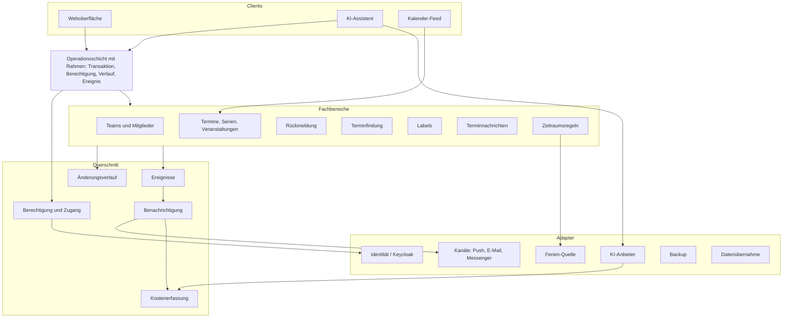

# Kapitel 5: Bausteinsicht

> **Stand: fachliche Kandidaten.** Die Bausteine ergeben sich aus dem Fachmodell und den Features. **Festgelegt ist die Prozessgrenze ([ADR-002](../09-entscheidungen/ADR-002-zerlegung-monolith-plus-worker.md)): eine Codebasis, zwei Prozesse, Web und Worker.** Die Codebasis ist ein Cargo-Workspace mit einem Crate je Baustein ([ADR-009](../09-entscheidungen/ADR-009-teststrategie-und-architekturregeln.md)); der genaue Zuschnitt der Crates ist noch festzulegen. Zwingend sind die Abhängigkeitsrichtungen unten.

## Ebene 1: Überblick

## Bausteine

| Baustein | Verantwortung | Anforderungen |
|---|---|---|
| Weboberfläche | Einfache, mobile Oberfläche für den Alltag; bildet nicht alle Funktionen ab. SPA und PWA mit Svelte, Gastseite als eigener Einstieg, eigener Service Worker ([ADR-007](../09-entscheidungen/ADR-007-frontend-spa-svelte.md), [ADR-008](../09-entscheidungen/ADR-008-sitzung-und-gast-identitaet.md)) | [QA-005](../../req42/06-qualitaet/QA-005-bedienbarkeit-mobil.md), [RB-011](../../req42/07-randbedingungen/RB-011-einfache-weboberflaeche-vollstaendige-funktionen-ueber-assistent.md) |
| KI-Assistent | Dialog, Vorschau und Freigabe schreibender Operationen, ruft Operationen mit den Rechten der Person auf; eigener Baustein im Web-Prozess und Client der Operationsschicht, Schleife im Server ([ADR-006](../09-entscheidungen/ADR-006-ki-anbindung.md)) | [FA-015](https://github.com/LetsFinishSchool/chronos-v3/issues/80) |
| Operationsschicht | Vollständige Menge benannter Fachoperationen; einziger Weg für Zustandsänderungen und Abfragen. Der **Rahmen** trägt Transaktion, Berechtigung, Verlauf, Ereignis, Vorschau per Probelauf, Freigabe-Beleg und Stapel ([ADR-005](../09-entscheidungen/ADR-005-operationsschicht.md)); Operationen enthalten nur Fachlogik | [RB-011](../../req42/07-randbedingungen/RB-011-einfache-weboberflaeche-vollstaendige-funktionen-ueber-assistent.md) |
| Teams und Mitglieder | Team-Baum, Mitgliedschaft (erbt nach oben), Einladungen, Gäste | [FA-001](https://github.com/LetsFinishSchool/chronos-v3/issues/8), [FA-002](https://github.com/LetsFinishSchool/chronos-v3/issues/49) |
| Termine, Serien, Veranstaltungen | Termine (Treffen, Frist/Marke), Serien mit RRULE und Ausnahmen, Veranstaltungen als Klammer, Zeitzonen | [FA-003](https://github.com/LetsFinishSchool/chronos-v3/issues/13), [FA-004](https://github.com/LetsFinishSchool/chronos-v3/issues/62), [FA-014](https://github.com/LetsFinishSchool/chronos-v3/issues/75) |
| Rückmeldung | Antworten je Termin/Vorkommen, Übersicht, Erinnerungsbedarf | [FA-005](https://github.com/LetsFinishSchool/chronos-v3/issues/17) |
| Terminfindung | Vorschläge, Stimmen, Festlegen erzeugt Termin | [FA-006](https://github.com/LetsFinishSchool/chronos-v3/issues/57) |
| Labels | Freitext-Labels je Bereich | [FA-007](https://github.com/LetsFinishSchool/chronos-v3/issues/66) |
| Terminnachrichten | Nachrichten je Termin | [FA-010](https://github.com/LetsFinishSchool/chronos-v3/issues/72) |
| Zeitraumsregeln | Dauerhafte Regeln, die bestehende und künftige Termine betreffen | [FA-016](https://github.com/LetsFinishSchool/chronos-v3/issues/88) |
| Berechtigung und Zugang | Wer darf was; Mitgliedschaft, Gastlinks, Token; Sitzung als BFF mit Heartbeat und Back-Channel-Logout, Gast-Cookie mit Rückkehr-Link ([ADR-008](../09-entscheidungen/ADR-008-sitzung-und-gast-identitaet.md)) | [M-002](../../req42/05-modelle/M-002-berechtigungen.md) |
| Änderungsverlauf | Anzeige von Akteur, Aktion, Zeitpunkt und Bündel-ID, vom Rahmen geschrieben; Wiederherstellung gelöschter Objekte 30 Tage (kein allgemeines Rückgängig) | [FA-017](https://github.com/LetsFinishSchool/chronos-v3/issues/32) |
| Ereignisse | Fachliche Vorkommnisse mit benanntem Auslöser | [QA-002](../../req42/06-qualitaet/QA-002-nachvollziehbarkeit.md), [M-004](../../req42/05-modelle/M-004-benachrichtigungsmatrix.md) |
| Benachrichtigung | Empfänger, Kanalwahl, Bündelung, Zustellung, Wiederholung, Protokoll, Erinnerungsplanung | [FA-008](https://github.com/LetsFinishSchool/chronos-v3/issues/22), [QA-004](../../req42/06-qualitaet/QA-004-zuverlaessige-benachrichtigung.md), [QA-010](../../req42/06-qualitaet/QA-010-benachrichtigungsbudget.md) |
| Kostenerfassung | Einzelposten je Benutzer/Team, Monatslimit KI | [FA-018](https://github.com/LetsFinishSchool/chronos-v3/issues/39) |
| Kalender-Feed | Persönlicher iCalendar-Abruf mit Token | [FA-009](https://github.com/LetsFinishSchool/chronos-v3/issues/69) |
| Adapter | Kapseln je einen Nachbarn (Identität, Kanäle, KI, Ferien, Backup) | [Kapitel 3](../03-kontext/02-technischer-kontext.md) |
| Datenübernahme | Wiederholbarer Import aus chronos-root mit Abgleich der Datensatzzahlen | [FA-012](https://github.com/LetsFinishSchool/chronos-v3/issues/1) |

Rechtliche Seiten ([F-013](https://github.com/LetsFinishSchool/chronos-v3/issues/31)) und Anmeldung ([F-011](https://github.com/LetsFinishSchool/chronos-v3/issues/28)) sind Teil von Oberfläche bzw. Identitäts-Adapter.

## Zwingende Abhängigkeitsregeln (aus QA-003 und RB-011)

1. Clients (Oberfläche, Assistent) greifen **nur** über die Operationsschicht zu. Der Feed liest ausschließlich.
2. Fachbereiche kennen **keine Kanäle** und keine Anbieter; sie erzeugen nur Ereignisse (QA-003 a).
3. Benachrichtigung und Rückmeldung kennen **keine konkreten Terminarten** (QA-003 b).
4. Jeder kostenverursachende Aufruf geht durch die Kostenerfassung.
5. Diese Regeln erzwingt der Compiler über die Crate-Grenzen des Cargo-Workspace ([ADR-009](../09-entscheidungen/ADR-009-teststrategie-und-architekturregeln.md)); `cargo-deny` (`bans`) ergänzt sie um verbotene Bibliotheken ([ADR-013](../09-entscheidungen/ADR-013-build-ci-lieferkette.md)).
6. Der Fachkern nutzt `jiff`; `chrono` bleibt an den Rändern ([ADR-012](../09-entscheidungen/ADR-012-zeitbibliothek.md)). Fachlogik ruft keine Adapter und prüft keine Berechtigung selbst; beides liegt im Rahmen.

## Zuordnung zu Prozessen (ADR-002)

| Prozess | Bausteine |
|---|---|
| Web | Weboberfläche (Auslieferung), Operationsschicht mit Rahmen, Fachbereiche, Berechtigung, Verlauf, Ereignis erzeugen, Kalender-Feed, KI-Assistent und KI-Adapter ([ADR-006](../09-entscheidungen/ADR-006-ki-anbindung.md)) |
| Worker | Zeitauslöser, Benachrichtigung (Zustellung, Wiederholung, Bündelung), Kanäle, Sitzungs-Heartbeat (Erneuerung der Keycloak-Sitzung alle 6 Stunden) |
| Unterbefehle desselben Binarys | `chronos migrate` als Job vor dem Rollout ([ADR-011](../09-entscheidungen/ADR-011-migrationswerkzeug.md)); Datenübernahme (E-017) als Import über die Operationsschicht |
| offen | Zuordnung von Backup (E-010: S3, clientseitig verschlüsselt) und Ferien-Abruf zu Web, Worker oder Job |

## Ebene 2: Rahmen der Operationsschicht ([ADR-005](../09-entscheidungen/ADR-005-operationsschicht.md))

Jede Operation ist ein Trait mit Name, Beschreibung, lesend oder schreibend, `Params` und `Result` mit Schema, Geltungsbereich und Fachlogik; sie wird über `inventory` registriert. Der Rahmen führt jeden Aufruf in dieser Reihenfolge aus:

1. Transaktion öffnen (lesende Operationen als `READ ONLY`).
2. Geltungsbereich aus den Parametern ableiten und gegen die Akteur-Art prüfen ([K-002](../08-konzepte/K-002-berechtigung-und-zugang.md)); geprüften Kontext erzeugen (nur der Rahmen kann ihn erzeugen, er enthält keine Adapter).
3. Fachlogik ausführen; Änderungen und Ereignisse werden gesammelt.
4. Verlauf mit Akteur und Bündel-ID sowie Ereignisse (Outbox) in derselben Transaktion schreiben ([K-004](../08-konzepte/K-004-aenderungsverlauf-und-rueckgaengig.md)).
5. Committen, oder bei einer **Vorschau** zurückrollen: Die Vorschau ist der Probelauf mit Rollback; der Rahmen bildet sie aus den gesammelten Änderungen und stellt einen **Freigabe-Beleg** (gültig 10 Minuten) aus. Aufrufe des Assistenten werden nur mit gültigem Beleg ausgeführt; Stapel laufen als eine Transaktion mit einer Bündel-ID (Obergrenze 50 Aufrufe oder 500 Objekte).

Weitere Detailsichten (Crate-Zuschnitt) folgen, sobald er festgelegt ist.
