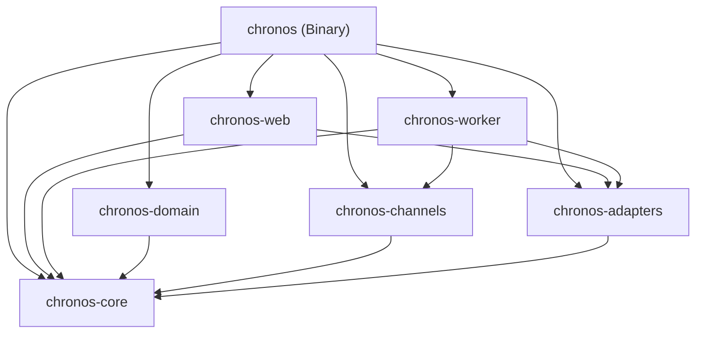

# Kapitel 5: Crate-Zuschnitt

Diese Seite legt fest, **welche Crates der Cargo-Workspace hat, wer von wem abhängen darf und wofür jedes Crate zuständig ist und wofür nicht**. Sie konkretisiert [ADR-009](../09-entscheidungen/ADR-009-teststrategie-und-architekturregeln.md) (ein Crate je Baustein) und die Abhängigkeitsregeln aus der [Bausteinsicht](01-bausteinsicht.md). Der Product Owner hat die Zusammenfassung der Adapter in ein Crate am 2026-11-24 im Gespräch entschieden und den Zuschnitt am selben Tag freigegeben.

## Überblick

**Erlaubte Kanten** (Positivliste; jede andere ist verboten):

| Crate | Pfad | darf abhängen von |
|---|---|---|
| `chronos` | `crates/chronos` | alle anderen |
| `chronos-core` | `crates/core` | nichts im Workspace |
| `chronos-domain` | `crates/domain` | `chronos-core` |
| `chronos-channels` | `crates/channels` | `chronos-core` |
| `chronos-adapters` | `crates/adapters` | `chronos-core` |
| `chronos-web` | `crates/web` | `chronos-core`, `chronos-adapters` |
| `chronos-worker` | `crates/worker` | `chronos-core`, `chronos-channels`, `chronos-adapters` |

**Was die Kanten durchsetzen:**
- `web` kennt `domain` nicht: Clients greifen nur über die Operationsschicht zu (Regel 1). Die Operationen werden über `inventory` in `core` registriert; `chronos` bindet `domain` mit `use chronos_domain as _;` ein, damit sie gelinkt sind.
- `domain` kennt weder `channels` noch `adapters`: Fachbereiche erzeugen nur Ereignisse und erreichen keine Nachbarsysteme (Regel 2, [ADR-005](../09-entscheidungen/ADR-005-operationsschicht.md)).
- `web` kennt `channels` nicht: Zustellung ist Sache des Workers.
- Nichts hängt von `chronos` ab, und `core` hängt von nichts ab, damit Zyklen unmöglich sind.

**Sicherung:** Der Compiler verhindert Importe ohne Eintrag in der `Cargo.toml`. Er verhindert nicht, dass eine verbotene Kante in die `Cargo.toml` **eingetragen** wird. Deshalb prüft ein Test über `cargo metadata` die Kanten gegen die Positivliste, und `cargo-deny` (`bans` mit `wrappers`) beschränkt Bibliotheken je Crate ([ADR-013](../09-entscheidungen/ADR-013-build-ci-lieferkette.md)).

Einordnungsregel: Entscheidet die Sache, **was fachlich gilt**, gehört sie nach `domain`. Entscheidet sie, **wie jede Operation abläuft** (Transaktion, Berechtigung, Verlauf, Ereignis), nach `core`. Spricht sie mit einem **Zustellkanal** (Push, E-Mail), nach `channels`, mit einem **anderen Nachbarsystem** (Identität, KI, Ferien, Backup), nach `adapters`. Nimmt sie **Anfragen von außen** an, nach `web`; läuft sie **ohne Anfrage im Hintergrund**, nach `worker`. Verdrahtet sie nur, nach `chronos`.

## chronos (Binary)

**Zuständig**
- Einstiegspunkt mit den Unterbefehlen `serve`, `worker` und `migrate` (später Import, E-017); ein Image für alle ([ADR-002](../09-entscheidungen/ADR-002-zerlegung-monolith-plus-worker.md), [ADR-011](../09-entscheidungen/ADR-011-migrationswerkzeug.md)).
- Konfiguration aus Umgebung und Secrets laden, Logging und Tracing initialisieren.
- Alles zusammenstecken: `domain` einbinden, Adapter und Kanäle erzeugen und an Web und Worker übergeben.
- Eingebettete Migrationen für `chronos migrate`: **ein** Verzeichnis `crates/chronos/migrations/` mit allen Migrationen, auch denen der Fachtabellen (`sqlx::migrate!` bettet genau ein Verzeichnis ein).

**Nicht zuständig**
- Fachlogik, Berechtigungen, Protokolle: Alles, was ein anderes Crate brauchen könnte, gehört dorthin. Von `chronos` hängt nichts ab.

## chronos-core

**Zuständig**
- Operationsschicht ([ADR-005](../09-entscheidungen/ADR-005-operationsschicht.md)): Operation-Trait, Registrierung über `inventory`, Rahmen mit Transaktion, Geltungsbereich und Berechtigungsprüfung, Verlauf, Outbox, Probelauf, Freigabe-Beleg und Stapel.
- Geprüfter Kontext (nur der Rahmen kann ihn erzeugen, er enthält keine Adapter), Akteur-Arten (Person, Gast, später Assistent, Regel, Import), Fehlercodes, gemeinsame Typen für Ereignisse und Verlauf.
- Zeittypen ([ADR-012](../09-entscheidungen/ADR-012-zeitbibliothek.md)), Schnittstelle der Kostenerfassung (Regel 4, [K-005](../08-konzepte/K-005-kostenerfassung.md)), Zugang zur Datenbank für den Rahmen.

**Nicht zuständig**
- Konkrete Fachlogik, Fachtabellen und Fachereignisse (`domain`).
- HTTP, Sitzungen, Oberfläche (`web`); Kanäle (`channels`); Nachbarsysteme (`adapters`); Zustellung und Zeitauslöser (`worker`).
- Abhängigkeiten zu anderen Workspace-Crates.

## chronos-domain

**Zuständig**
- Die Fachbereiche aus der Bausteinsicht: Teams und Mitglieder, Termine, Serien und Veranstaltungen, Rückmeldung, Terminfindung, Labels, Terminnachrichten, Zeitraumsregeln.
- Operationen als **reine Fachlogik** im Rahmen, einschließlich der Ableitung des Geltungsbereichs aus den Parametern und der zugehörigen SQL-Abfragen; Fachtabellen als Migrationen im gemeinsamen Verzeichnis von `chronos` (siehe dort); Anzeige-Operationen (z. B. Änderungsverlauf lesen).
- Fachereignisse **erzeugen** (Name, Auslöser). Die RRULE-Auswertung liegt isoliert in einem eigenen Modul ([ADR-004](../09-entscheidungen/ADR-004-sprache-und-laufzeit.md)).

**Nicht zuständig**
- Berechtigung selbst prüfen, Transaktion steuern, Verlauf oder Outbox schreiben (Rahmen in `core`).
- Zustellkanäle und Nachbarsysteme (`channels`, `adapters`), HTTP, Zeitauslöser.
- Verzweigungen nach Terminart in Rückmeldung und Benachrichtigung ([QA-003](../../req42/06-qualitaet/QA-003-aenderbarkeit.md) b).

## chronos-channels

**Zuständig**
- Adapter für die Zustellkanäle: Web Push, E-Mail (SMTP), später Messenger; eine gemeinsame Kanalschnittstelle mit kanalspezifischen Formaten und Grenzen.
- Rückmeldung des Ergebnisses je Zustellversuch (zugestellt, vorübergehend oder dauerhaft fehlgeschlagen, z. B. abgelaufenes Abo).
- Kostenverursachende Aufrufe über die Kostenerfassung aus `core` melden (Regel 4).

**Nicht zuständig**
- Entscheiden, wer wann über welchen Kanal benachrichtigt wird, Bündelung, Budget, Wiederholung, Protokoll (`worker`).
- Ereignisse erzeugen oder lesen, Fachlogik, Datenbankzugriff am Rahmen vorbei.
- Andere Nachbarsysteme (Identität, KI, Ferien, Backup): Sie liegen in `adapters`.

## chronos-adapters

Ein Crate mit **einem Modul je Nachbarsystem**. Gebündelt statt je Adapter ein Crate, weil eine verbotene Kante („Fachbereiche erreichen keine Adapter“) dann nur einmal in der Positivliste und im Test steht, weniger Konfiguration anfällt und die Grenzen zwischen den Adaptern noch nicht erprobt sind. Ein Modul in ein eigenes Crate zu verschieben ist günstig, mehrere Crates wieder zusammenzulegen nicht ([ADR-009](../09-entscheidungen/ADR-009-teststrategie-und-architekturregeln.md), Folgen).

**Zuständig**
- **Identität (Keycloak):** OIDC-Anmeldung, Token- und Sitzungsprüfung, Erneuerung der Sitzung (Heartbeat), Back-Channel-Logout; genutzt von `web` und `worker` ([ADR-008](../09-entscheidungen/ADR-008-sitzung-und-gast-identitaet.md)).
- **KI-Gateway:** schmaler Client hinter der Schnittstelle `AiProvider` mit dem Adapter „OpenAI-kompatibel“ für das LiteLLM-Gateway; Kostenerfassung für KI-Aufrufe ([ADR-006](../09-entscheidungen/ADR-006-ki-anbindung.md)).
- **Ferien-Quelle:** Abruf der Schulferien.
- **Backup:** S3-kompatibler Objektspeicher, clientseitige Verschlüsselung.
- Je Adapter eine Schnittstelle (Trait), damit Web, Worker und Tests ihn austauschen können.

**Nicht zuständig**
- Zustellkanäle (`channels`).
- Fachlogik und Entscheidungen, wann ein Aufruf nötig ist (`domain`, `web`, `worker`).
- Aufrufe aus `domain`: Fachbereiche kennen keine Adapter. Brauchen sie Daten aus einem Nachbarsystem, liegen sie als Daten in der Datenbank.
- Abhängigkeiten zu `channels`, `web`, `worker`, `domain`.

## chronos-web

**Zuständig**
- HTTP-Server: `POST /api/v1/operations/{name}`, Stapelendpunkt, Operationsliste für Oberfläche und Frontend-Typen, Abbildung von Fehlercodes auf HTTP, Korrelations-ID je Anfrage.
- Auslieferung der SPA (statischer Build) und der Gastseite mit eingebetteten Termindaten ([ADR-007](../09-entscheidungen/ADR-007-frontend-spa-svelte.md)).
- Sitzung als BFF (Cookie, Back-Channel-Logout-Endpunkt) und Gast-Cookie; Kalender-Feed (nur lesend, über Operationen).
- Der KI-Assistent als Baustein im Web-Prozess ruft ausschließlich Operationen auf und nutzt den KI-Adapter aus `adapters`.

**Nicht zuständig**
- Fachlogik, Berechtigungsprüfung, direkter Zugriff auf Fachdaten: `web` kennt `domain` nicht und ruft nur über die Registrierung in `core`.
- Zustellkanäle und Zustellung (`channels`, `worker`).
- Hintergrundarbeit ohne Anfrage (`worker`).

## chronos-worker

**Zuständig**
- Outbox abarbeiten (`FOR UPDATE SKIP LOCKED`), Verbraucher je Ereignisart ([K-003](../08-konzepte/K-003-ereignisse-und-benachrichtigung.md)).
- Benachrichtigung: Empfänger, Kanalwahl nach Einstellungen und Matrix, Bündelung, Budget beim Planen, Wiederholung, Zustellprotokoll mit Auslöser, Erinnerungsplanung.
- Zeitauslöser und Wartung, z. B. Sitzungs-Heartbeat alle 6 Stunden und Bereinigung gelöschter Objekte nach 30 Tagen.
- Änderungen an Fachdaten nur **über Operationen** mit der Akteur-Art Regel, nie am Rahmen vorbei.

**Nicht zuständig**
- HTTP, Oberfläche, Sitzungen von Anfragen (`web`).
- Kanalspezifischer Versandcode (`channels`) und Code für Nachbarsysteme (`adapters`): Der Worker ruft nur deren Schnittstellen.
- Fachregeln (`domain`): Der Worker entscheidet, wann etwas geschieht, die Fachlogik, was.

## Offene Punkte

- **Ferien-Quelle und Zeitraumsregeln:** Die Bausteinsicht (Ebene 1) zeichnet eine Kante von den Zeitraumsregeln zur Ferien-Quelle. Mit diesem Zuschnitt darf `domain` keinen Adapter aufrufen; der Abruf muss deshalb als Daten (Ferienzeiträume in der Datenbank) ankommen, nicht als Aufruf aus `domain`. Zu bestätigen bei der Umsetzung von [F-016](https://github.com/LetsFinishSchool/chronos-v3/issues/88).
- **Prozesszuordnung von Backup und Ferien-Abruf** (Web, Worker oder Job) bleibt offen ([Bausteinsicht](01-bausteinsicht.md), Zuordnung zu Prozessen, E-010). Sie ändert den Crate-Zuschnitt nicht.
- **Eigenes Crate je Adapter:** Wird eine genauere Kante nötig (z. B. „der Worker darf den KI-Client nicht kennen“) oder soll eine Bibliothek hart auf ein Adaptermodul beschränkt werden, wird dieses Modul in ein eigenes Crate herausgelöst. Positivliste und Test sind dann anzupassen.
- **Benachrichtigung im Worker:** Wächst sie über den Rahmen von `worker` hinaus, wird sie ein eigenes Crate ([ADR-009](../09-entscheidungen/ADR-009-teststrategie-und-architekturregeln.md), „Wann überprüfen“).
