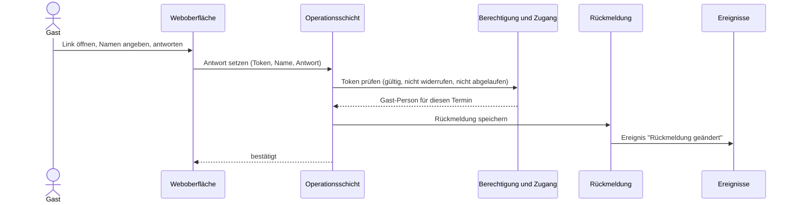
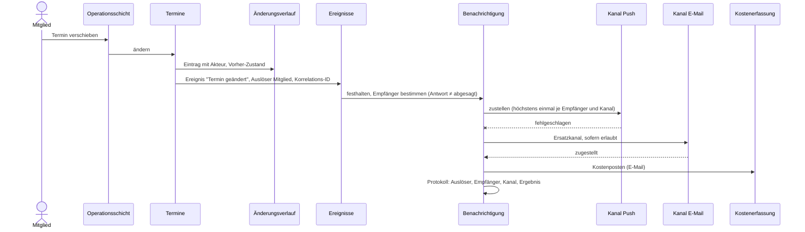
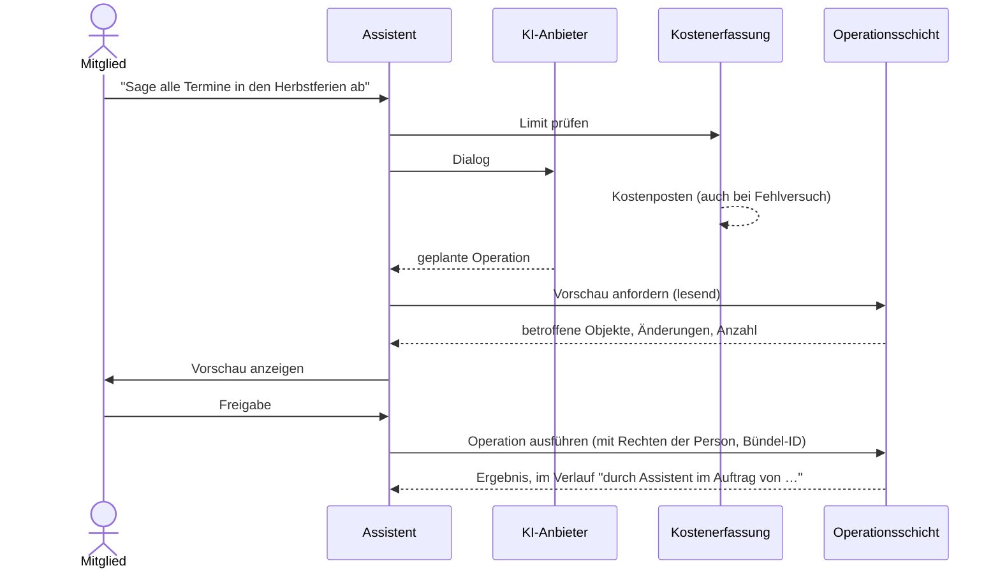
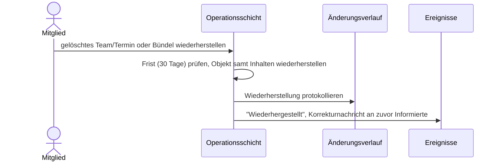

# Kapitel 6: Laufzeitsicht

Die Szenarien zeigen das **geforderte Verhalten** zwischen den [Bausteinen](../05-bausteine/01-bausteinsicht.md) (Kandidaten). Technische Mechanismen (Outbox, Worker, Transaktionsgrenzen, siehe [ADR-005](../09-entscheidungen/ADR-005-operationsschicht.md)) sind hier abstrakt als „festhalten“ bzw. „Zeitauslöser“ bezeichnet.

## L-1 Antwort über Gastlink


Antwort in ≤ 3 Interaktionen ([QA-005](../../req42/06-qualitaet/QA-005-bedienbarkeit-mobil.md)). Ein widerrufener oder abgelaufener Link liefert keine Daten.

## L-2 Termin ändern und Benachrichtigung zustellen


Das Ereignis wird vor der Zustellung dauerhaft festgehalten; ein Neustart während des Versands verliert nichts und stellt nichts doppelt zu ([QA-004](../../req42/06-qualitaet/QA-004-zuverlaessige-benachrichtigung.md)).

## L-3 Automatische Rückmelde-Erinnerung

```mermaid
sequenceDiagram
  participant ZT as Zeitauslöser
  participant RM as Rückmeldung
  participant EV as Ereignisse
  participant NB as Benachrichtigung
  ZT->>RM: Termine in 7 Tagen / 3 Tagen / 2 Tagen mit offenen Rückmeldungen
  RM->>EV: Ereignis "Erinnerung" je betroffener Person; "Ausbleibend" an Leitung (einmalig, 2 Tage)
  EV->>NB: Empfänger je Person, Erinnerungen bündeln
  NB->>NB: Benachrichtigungsbudget der Person beachten (Planung, keine Sperre)
```
Zusätzlich einmal pro Woche eine Zusammenfassung der offenen Rückmeldungen der nächsten 14 Tage. Die Leitung muss nichts auslösen ([Z-010](../../req42/01-ziele/Z-010-rueckmeldungen-automatisch-einholen.md)).

## L-4 Assistent: Vorschau und Freigabe


Ohne Freigabe wird nichts geschrieben. Lesende Operationen brauchen keine Freigabe ([FA-015](https://github.com/LetsFinishSchool/chronos-v3/issues/80)). Ist das Monatslimit erreicht, pausiert die KI bis Monatsende.

## L-5 Zeitraumsregel wirkt auf bestehende und künftige Termine

1. Regel anlegen (nach Vorschau und Freigabe über den Assistenten): alle Termine im Zeitraum werden abgesagt, als **ein Bündel**, mit **einer** gebündelten Benachrichtigung je Empfänger.
2. Später wird im Zeitraum ein Termin angelegt: Er wird automatisch abgesagt; die anlegende Person erhält einen Hinweis, welche Regel gewirkt hat.
3. Regel aufheben: durch sie abgesagte Termine werden wieder geplant; manuell abgesagte bleiben abgesagt (Herkunft der Absage muss erkennbar sein).

## L-6 Gelöschtes wiederherstellen


Nach 30 Tagen wird endgültig gelöscht ([K-008](../08-konzepte/K-008-sicherheit-und-datenschutz.md)).

## L-7 Datenübernahme

Ablauf: Altdaten lesen → Abbildung nach [M-005](../../req42/05-modelle/M-005-migrationsabbildung.md) → schreiben → **Abgleich der Datensatzzahlen je Entität** mit dokumentierten Abweichungen. Wiederholbar, Altsystem bleibt unverändert, bestehende Keycloak-Kennungen bleiben gültig ([FA-012](https://github.com/LetsFinishSchool/chronos-v3/issues/1)). Die Übernahme löst keine Benachrichtigungen aus (zu entscheiden in E-017).
