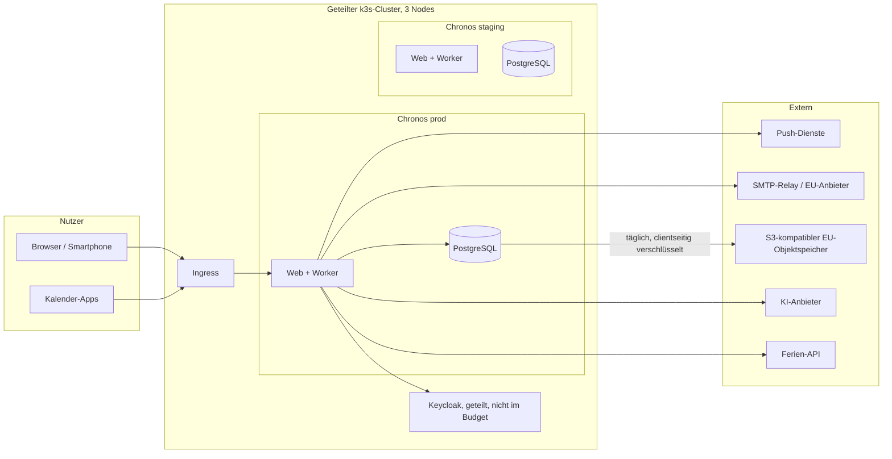

# Kapitel 7: Verteilungssicht

> **Stand:** Infrastruktur steht fest (k3s, Keycloak, S3, SMTP). **Festgelegt ([ADR-002](../09-entscheidungen/ADR-002-zerlegung-monolith-plus-worker.md), Entwurf):** Chronos läuft als zwei Prozesse, Web und Worker, mit gemeinsamer Datenbank. Datenbank: PostgreSQL in eigener Instanz ([ADR-003](../09-entscheidungen/ADR-003-datenbank-postgresql.md), Entwurf). **Offen:** Zuordnung von KI, Backup und Import.

## Ebene 1: Infrastruktur

## Festgelegte Eigenschaften

| Aspekt | Vorgabe | Quelle |
|---|---|---|
| Plattform | k3s, 3 Nodes (1× 4 vCPU/8 GB, 2× 2 vCPU/4 GB), geteilt mit vielen Anwendungen | [BM-001](../../req42/09-betriebsmittel-personal/BM-001-laufzeitumgebung.md) |
| Budget | ca. 1 vCPU / 1 GiB für alle Chronos-Komponenten, besser weniger; Keycloak nicht eingerechnet | [RB-003](../../req42/07-randbedingungen/RB-003-ressourcenbudget.md) |
| Umgebungen | prod (löst das bisherige System ab) und staging, beide im geteilten Cluster | [RB-005](../../req42/07-randbedingungen/RB-005-betrieb-auf-geteiltem-k3s-cluster.md) |
| Datensicherung | täglich, clientseitig verschlüsselt, S3-kompatibler EU-Objektspeicher; RPO 24 h, RTO 8 h; regelmäßiger Wiederherstellungstest | [QA-006](../../req42/06-qualitaet/QA-006-datensicherung.md) |
| Konfiguration | Secrets und Zugangsdaten nicht im Repository | [RB-008](../../req42/07-randbedingungen/RB-008-keine-geheimnisse-im-repository.md) |
| Beobachtung | Metriken und Logs mit Korrelations-ID | [QA-002](../../req42/06-qualitaet/QA-002-nachvollziehbarkeit.md) |
| Zusatzkosten | ≤ 10 €/Monat (Backup-Speicher, E-Mail, KI) | [RA-009](../../req42/12-risiken-annahmen/RA-009-budget-und-abhaengigkeit-von-keycloak.md) |
| Ausfall Keycloak | Niemand kann sich neu anmelden; Gäste mit Link bleiben nutzbar | [RA-009](../../req42/12-risiken-annahmen/RA-009-budget-und-abhaengigkeit-von-keycloak.md) |
| Ausfall des Betreibers | RTO 8 h dann nicht zugesichert (akzeptiertes Restrisiko) | [RA-003](../../req42/12-risiken-annahmen/RA-003-betrieb-und-entwicklung-haengen-an-einer-person.md) |

## Zuordnung Bausteine → Infrastruktur

Web und Worker je als eigener Container je Umgebung (**entschieden, PO 2026-11-20:** zwei Images; je Umgebung eine eigene PostgreSQL-Instanz, Gesamtbedarf bleibt im Budget zu belegen). **Entschieden (PO 2026-11-20):** staging nutzt eigene Testdaten, echte Altdaten nur im Migrations-Probelauf; Deployment über Manifeste im Repository, per CI angewendet (kubectl/kustomize). **Entschieden (PO 2026-11-20):** prod und staging haben je eigene Limits von 1 vCPU und 1 GiB, in beiden Umgebungen gleich, damit Vergleiche aussagekräftig sind. Aufteilung innerhalb einer Umgebung auf Web, Worker und Datenbank: zu bestimmen und durch den Lasttest zu belegen. Randbedingung für alle Optionen: Gesamtbedarf innerhalb des Budgets, belegt durch Lasttest mit 500 Nutzern ([QA-001](../../req42/06-qualitaet/QA-001-ressourceneffizienz.md)).
