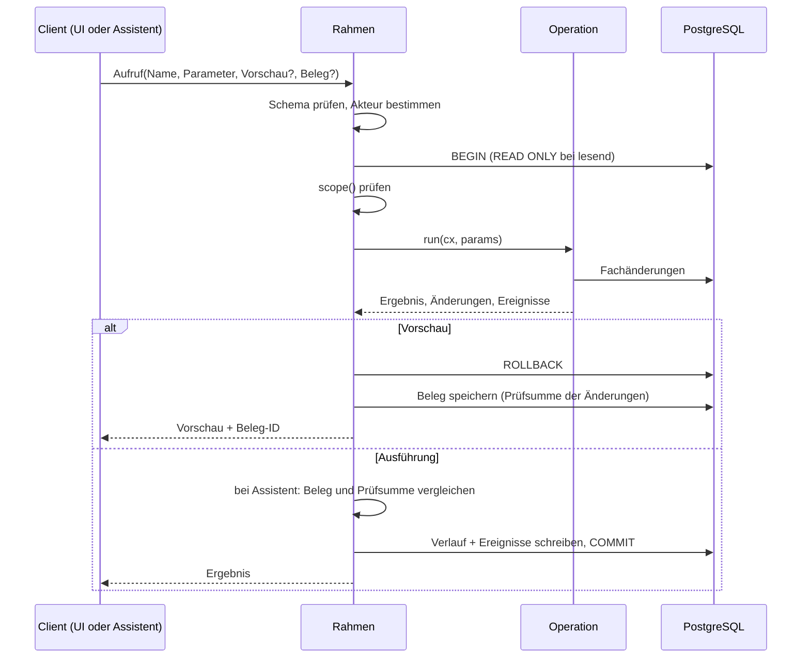

# E-005: Form der Operationsschicht, Analyse

Entscheidungsvorlage für [E-005](01-offene-entscheidungen.md). **Entschieden (PO 2026-11-23): Gesamtvariante V2, siehe [ADR-005](ADR-005-operationsschicht.md).** Sprache: Rust ([ADR-004](ADR-004-sprache-und-laufzeit.md), freigegeben 2026-11-23). Nur die Teilfrage T1 hängt an der Sprache, T2 bis T6 gelten für jede Sprache (siehe „Wenn nicht Rust“). Die Bewertungen sind Einschätzungen, keine Messungen; belegt ist nur, was im Abschnitt „Befund aus dem Spike“ steht.

## Frage

Wie wird eine Fachoperation beschrieben, und wie sorgt die Schicht dafür, dass jede Operation **ohne Zutun der Entwicklerin oder des Agenten** durch Berechtigung, Transaktion, Verlauf, Ereignisbildung, Vorschau und Freigabe läuft (Leitlinie 3 „Ein Weg für alles“, Kapitel 4)? Risiko R-A2 (Kapitel 11): Die Schicht wird zum Nadelöhr, wenn sie diese Dinge nicht selbst liefert.

## Anforderungen an die Schicht

| Nr. | Anforderung | Quelle |
|---|---|---|
| A1 | Einziger Weg für Zustandsänderungen und Abfragen; UI und Assistent sind gleichrangige Clients | RB-011, Kapitel 5 Regel 1 |
| A2 | **Eine** Beschreibung erzeugt Endpunkt, Validierung, Operationsliste, KI-Werkzeug und Frontend-Typen; keine zweite Liste von Hand | QA-003 c, K-006 |
| A3 | Maschinenlesbar: Name, Parameter, lesend/schreibend, Wirkung | K-006 |
| A4 | **Jede** schreibende Operation liefert eine Vorschau ohne Wirkung (betroffene Objekte, Änderungen, Anzahl) | FA-015 AK 2, K-006 |
| A5 | Ohne Freigabe schreibt der Assistent nichts; Prompt-Injection darf den Freigabezwang nicht umgehen | FA-015 AK 2, RA-010 |
| A6 | Berechtigungsprüfung an **einer** Stelle; Rechte der angemeldeten Person; Gast nur im Umfang seines Links | K-002, FA-015 AK 4 |
| A7 | Verlauf als Querschnitt: Akteur (Person, „Assistent im Auftrag von …“, Regel), Aktion, Zeitpunkt, Bündel-ID | K-004, FA-015 AK 5 |
| A8 | Ereignis mit Auslöser und Korrelations-ID in derselben Transaktion wie die Änderung | QA-002, E-006 |
| A9 | Kostenverursachende Aufrufe nur über die Kostenerfassung | K-005, Kapitel 5 Regel 4 |
| A10 | Ergebnisse und Fehler sprachneutral, Texte in der Sprache der Person | RB-001, FA-015 AK 7 |
| A11 | Importmodus: Import nutzt die Schicht, Ereignisse werden markiert und nicht zugestellt | E-017 |
| A12 | Sammeländerungen (Zeitraumsregel, „alle Termine in den Herbstferien absagen“) als **ein** Bündel mit **einer** Benachrichtigung je Empfänger | L-4, L-5 |
| A13 | Geringer Aufwand je neuer Operation; Agenten legen sie richtig an, ohne Querschnitt zu kennen | ADR-001 Rang 1, R-A2, RA-003 |

## Befund aus dem Spike

V-1 war bewusst klein (keine Rollen, kein Bündel, Vorschau nur bei einigen Operationen). Lücken gegenüber den Anforderungen sind darum offene Entwurfsfragen und kein Versagen des Spikes.

**Belegt:**
- Beschreibung je Operation: Trait `Operation` (`NAME`, `DESCRIPTION`, `MUTATING`, `PREVIEW`, `Params`/`Result` mit `serde` + `utoipa::ToSchema`) plus `register!` über `inventory`. Daraus entstehen `/api/v1/operations`, `/api/v1/ai/tools`, die Validierung (`jsonschema`) und die TypeScript-Brücke (A2 erfüllt).
- Neue Operation (Phase 2, `appointment.reschedule`): 1 berührte Datei (M-11). Ein Test prüft „KI-Werkzeuge = Operationen“.
- Transport: RPC, `POST /api/v1/operations/{name}` mit `{params, preview}`.

**Offen gegenüber den Anforderungen:**

| Anf. | Spike | Folge |
|---|---|---|
| A6 | Jede Operation prüft selbst (`require_member`, 19 Stellen in 4 Dateien) | Prüfung verteilt; eine vergessene Prüfung fällt nur in Tests auf |
| A7, A8 | Jede Operation ruft `commit_change` selbst auf | Verlauf und Ereignis hängen an Disziplin |
| A7 | Bündel-ID neu je Verlaufseintrag; Akteur nur Personen-ID | Bündel und „Assistent im Auftrag von …“ fehlen |
| A4 | Vorschau ist eine zweite Methode; 4 von 10 schreibenden Operationen haben eine; Prüfungen stehen doppelt in `run` und `preview` | Vorschau und Wirkung können auseinanderlaufen; fehlende Vorschau fällt erst zur Laufzeit auf |
| A5 | `ai.ask` schlägt Aufrufe nur vor; ausgeführt wird über denselben Endpunkt wie die Oberfläche | Freigabe hängt am Client; der Server kann sie nicht nachweisen |
| A9 | Der Operationskontext enthält einen HTTP-Client | Eine Operation könnte Anbieter an der Kostenerfassung vorbei aufrufen |
| A2 | utoipa liefert OpenAPI-Schemas; KI-Werkzeuge brauchen JSON Schema ohne `$ref` → `normalize`, ca. 100 Zeilen Eigenbau | Pflege des Eigenbaus |

## Teilentscheidungen

E-005 zerfällt in sechs Teilfragen. T2 bis T5 bestimmen, ob die Schicht A4 bis A8 **erzwingt** oder nur **ermöglicht**.

### T1 Quelle der Beschreibung

| Option | Vorteile | Nachteile |
|---|---|---|
| **T1-A** Trait + verteilte Registrierung über `inventory` (wie Spike) | Im Spike belegt; 1 Datei je Operation; Typen werden beim Übersetzen geprüft | `inventory` registriert beim Linken: Fehlt `register!`, fehlt die Operation stillschweigend (nur ein Test bemerkt es); utoipa mit 1 Owner, `normalize` bleibt |
| **T1-B** Wie A, aber Schemas aus `schemars` (JSON Schema Draft 2020-12) | Passt direkt zum Format der KI-Werkzeuge; `normalize` schrumpft; `schemars` ist weit verbreitet | Ein OpenAPI-Dokument entsteht nicht von selbst (braucht ein Zusatz-Crate oder entfällt); unbelegt, Spike-Erweiterung nötig |
| **T1-C** Eigenes Attribut-Makro (`#[operation(name = "appointment.cancel", write)] async fn …`) | Am wenigsten Schreibarbeit; für Agenten deklarativ lesbar | Eigenes Proc-Macro = Eigenbau; Fehlermeldungen aus Makros schwer lesbar; längere Bauzeit |
| **T1-D** Schema-first: Operationen in YAML/JSON Schema, Rust- und TS-Typen generiert | Sprachneutral, übersteht einen Sprachwechsel | Zwei Artefakte (Beschreibung, Implementierung) können auseinanderlaufen; Codegeneratoren für Rust aus JSON Schema weniger ausgereift; `build.rs`-Aufwand |

Zur Registrierung: Statt `inventory` wäre eine zentrale Liste `operations![AppointmentCreate, …]` möglich. Sie ist ohne Link-Zeit-Mechanik und vom Compiler geprüft, kostet aber eine zweite Datei je Operation und widerspricht der Regel „keine zweite Liste von Hand“ aus V-1.

**Vorschlag:** T1-A, wobei T1-B in einer kurzen Spike-Erweiterung geprüft wird. Wechselt die Schemaquelle, betrifft das nur den Rahmen, nicht die Operationen.

### T2 Querschnitt: Transaktion, Berechtigung, Verlauf, Ereignis

| Option | Vorteile | Nachteile |
|---|---|---|
| **T2-A** Hilfsfunktionen, die jede Operation selbst aufruft (wie Spike) | Einfach, im Spike belegt, volle Freiheit je Operation | A6 bis A8 hängen an Disziplin; jede Operation wiederholt Transaktion, Prüfung, Verlauf |
| **T2-B** Der Rahmen umschließt die Operation: Er öffnet die Transaktion (lesende als `READ ONLY`), prüft den deklarierten Geltungsbereich, gibt der Operation einen Kontext mit geprüftem Akteur und einem Sammler für Änderungen und Ereignisse, schreibt danach Verlauf und Ereignisse und committet | A6 bis A8 und A11 an einer Stelle; Operationen enthalten nur Fachlogik; PostgreSQL erzwingt „lesend“; der Kontext enthält keine Adapter (A9) | Mehr Rahmencode (ca. 200 bis 400 Zeilen, Schätzung); Geltungsbereich muss sich aus den Parametern ableiten lassen; Sonderfälle (Gast, Feed, Import) brauchen eigene Bereichsarten |
| **T2-C** Wie B, aber der Verlauf entsteht über Trigger in PostgreSQL; Akteur und Bündel kommen über `SET LOCAL` | Selbst rohes SQL kann den Verlauf nicht umgehen; sprachneutral | Fachliche Aktion („Termin verschoben“) geht verloren, nur Zeilenänderungen bleiben; Logik in PL/pgSQL; schwerer zu testen und für Agenten schwerer zu überblicken |
| **T2-D** Ereignisprotokoll als Quelle (Event Sourcing) | Verlauf und Wiederherstellung fallen von selbst ab | Durch E-007/K-004 nicht mehr gefordert; großer Umbau; für eine Person mit Agenten zu schwer |

Zum Vergleich: T2-B entspricht in Spring `@Transactional` + `@PreAuthorize` + einem Audit-Aspekt. Rust hat keine AOP, deshalb sitzt der Rahmen in der generischen Aufruffunktion (`call_of::<T>` im Spike). Rust-spezifisch: Der geprüfte Kontext lässt sich als Typ bauen, den nur der Rahmen erzeugen kann (Konstruktor nicht öffentlich). Eine Operation **kann** dann gar nicht ohne Prüfung laufen.

**Vorschlag:** T2-B.

### T3 Vorschau

| Option | Vorteile | Nachteile |
|---|---|---|
| **T3-A** Eigene Methode `preview` je Operation (wie Spike) | Einfach; Vorschautext frei formulierbar | Zwei Codepfade, die auseinanderlaufen können; doppelte Prüfungen; mit einem Standardwert vergessbar (A4); mehr Code je Operation |
| **T3-B** Probelauf: dieselbe Operation läuft vollständig in der Transaktion, der Rahmen sammelt die Änderungen (aus T2-B) und rollt zurück | Vorschau = Wirkung, per Konstruktion; **kein Vorschaucode je Operation**; jede schreibende Operation hat automatisch eine Vorschau (A4, A13) | Sperren und Schreiblast während der Vorschau (bei < 500 Nutzern unkritisch, zu messen); Operationen dürfen keine Wirkung außerhalb der Datenbank haben (durch Outbox und T2-B ohnehin so); setzt T2-B voraus |
| **T3-C** Planen und Anwenden: `plan` (nur lesend) liefert einen Plan mit betroffenen Objekten und Änderungen, `apply` führt genau diesen Plan aus | Vorschau aus demselben Code; der Plan lässt sich speichern und genau so freigeben (passt zu T4-B); `apply` bekommt per Typ nur einen Plan | Jede Operation in zwei Teile zerlegen; Pläne für Operationen mit Folgen (Serien materialisieren, Zeitraumsregel) werden groß |

Zum Vergleich: T3-C ist das Muster von `terraform plan`/`apply`, T3-B ist ein „Dry Run“ mit Rollback.

**Vorschlag:** T3-B. Falls Messungen Sperrprobleme zeigen, ist T3-C der Ausweg; die Operationen ändern sich dabei nur in ihrer Aufteilung.

### T4 Freigabe

| Option | Vorteile | Nachteile |
|---|---|---|
| **T4-A** Client-seitig: Der Assistent schlägt vor, die Oberfläche zeigt die Vorschau und ruft nach Freigabe auf (wie Spike) | Einfach, kein Zustand im Server | Der Server kann die Freigabe weder nachweisen noch erzwingen; was ausgeführt wird, muss nicht dem entsprechen, was gezeigt wurde; versperrt einen späteren Assistenten, der im Server Schritte ausführt |
| **T4-B** Freigabe-Beleg im Server: Die Vorschau speichert Person, Operation(en), Parameter und eine Prüfsumme der Änderungen (Ablauf z. B. 10 min) und gibt eine Beleg-ID zurück. Aufrufe des Assistenten werden nur mit gültigem Beleg ausgeführt; der Rahmen vergleicht die Änderungen beim Ausführen erneut | A5 serverseitig erzwungen; „durch Assistent im Auftrag von …“ ist belegt; geänderter Zustand zwischen Vorschau und Freigabe führt zu „bitte neu bestätigen“ statt zu einer stillen Abweichung | Eine Tabelle und Ablauflogik; der Server muss Aufrufe des Assistenten von direkten UI-Aufrufen unterscheiden (eigener Zugang oder Akteur-Art) |
| **T4-C** Zwei Schritte für **alle** schreibenden Aufrufe, auch aus der Oberfläche | Ein einheitlicher Weg | Die Oberfläche wird umständlicher (Bedienbarkeit, ADR-001 Rang 2); von FA-015 nicht gefordert |

**Vorschlag:** T4-B. Direkte Aufrufe aus der Oberfläche bleiben einstufig, weil die Person dort selbst handelt.

### T5 Bündel und mehrere Aufrufe

| Option | Vorteile | Nachteile |
|---|---|---|
| **T5-A** Ein Aufruf = ein Bündel; Sammeländerungen sind eigene fachliche Operationen (`appointment.cancel_range`) | Einfach, atomar | Für jede Kombination, die der Assistent braucht, eine eigene Operation; die Zahl der Operationen wächst |
| **T5-B** Stapel: Der Assistent schlägt eine Folge von Aufrufen vor; Vorschau und Freigabe gelten für den ganzen Stapel; alles läuft in einer Transaktion mit einer Bündel-ID | Beliebige Kombinationen ohne neue Operationen; alles oder nichts; eine gebündelte Benachrichtigung je Empfänger (A12) ist über die Bündel-ID möglich | Setzt T2-B voraus (der Rahmen hält die Transaktion); große Stapel = lange Transaktion; Obergrenze nötig |
| **T5-C** Stapel ohne gemeinsame Transaktion, nur mit gemeinsamer Bündel-ID | Kurze Transaktionen | Halb ausgeführte Stapel; Vorschau gilt nur für den ersten Schritt sicher |

**Vorschlag:** T5-B mit Obergrenze (z. B. 50 Aufrufe oder 500 betroffene Objekte, Wert offen). Zeitraumsregeln (FA-016) bleiben eigene Operationen, weil sie auch künftige Termine betreffen.

### T6 Transport

| Option | Vorteile | Nachteile |
|---|---|---|
| **T6-A** RPC: `POST /api/v1/operations/{name}` (wie Spike), Stapel über `POST /api/v1/batches` | Entspricht 1:1 den Werkzeugen; ein Endpunkt; Brücke trivial; neue Operation ohne Routing | Keine HTTP-Semantik (kein Caching für lesende Aufrufe, Logs weniger sprechend) |
| **T6-B** REST-Abbildung: Jede Operation deklariert Methode und Pfad, OpenAPI als Vertrag | Vertraut für Dritte, HTTP-Caching | Zusatzangabe je Operation; Fachoperationen wie „absagen“ passen schlecht auf Ressourcen; zweites Modell neben der Operationsliste |
| **T6-C** RPC, lesende Operationen zusätzlich als `GET` mit Parametern | Caching für lesende Aufrufe möglich | Parameter in der Adresse (Länge, Logs mit personenbezogenen Daten) |

Eine öffentliche API für Dritte ist nicht gefordert. Der Kalender-Feed hat ohnehin einen eigenen Endpunkt.

**Vorschlag:** T6-A.

### Kleinere Festlegungen (ohne echte Alternativen)

- **Akteur-Arten im Kontext:** Person, Assistent im Auftrag von Person, Regel (ID), Gast (Link), Import. Der Verlauf übernimmt sie unverändert (A7, A11).
- **Fehler als Codes** (`validation_error`, `forbidden`, `not_found`, `conflict`, `approval_required`, `approval_stale`) mit Parametern; Texte entstehen erst in der Oberfläche oder in der Antwort des Assistenten (A10).
- **Namen** `bereich.verb`, stabil. Umbenennen heißt neue Operation plus Übergangszeit, weil Werkzeugnamen und Frontend-Typen daran hängen.
- **Fachliche statt technischer Operationen:** `appointment.reschedule`, nicht `appointment.update` mit beliebigen Feldern. Das gibt bessere Werkzeugbeschreibungen und genauere Verlaufseinträge.
- **Prüfungen im Test:** Schnappschuss der Operationsliste und Schemas (Änderungen werden im Review sichtbar); „jede schreibende Operation hat eine Vorschau“ ist bei T3-B kein Test mehr, sondern eine Eigenschaft des Rahmens.

## Gesamtvarianten

Die Teilentscheidungen hängen zusammen: T3-B und T5-B setzen T2-B voraus, T4-B wird mit T3-B oder T3-C erst genau. Deshalb drei stimmige Pakete:

| | V1 Spike härten | V2 Rahmen trägt den Querschnitt | V3 Schema-first |
|---|---|---|---|
| T1 Quelle | A (Trait) | A, B prüfen | D (YAML/JSON Schema) |
| T2 Querschnitt | A (Hilfsfunktionen) | **B (Rahmen)** | B |
| T3 Vorschau | A (eigene Methode, Pflicht per Test) | **B (Probelauf)** | B |
| T4 Freigabe | A (Client) | **B (Beleg im Server)** | B |
| T5 Bündel | A (eigene Sammeloperationen) | **B (Stapel)** | B |
| T6 Transport | A (RPC) | A | A |

**Bewertung** (`++` sehr gut, `+` gut, `o` mittel, `-` schwach; Einschätzung):

| Kriterium (ADR-001-Rang) | V1 | V2 | V3 |
|---|---|---|---|
| Aufwand je neuer Operation, R-A2 (1) | o (Fachlogik + Vorschau + Prüfung + Verlauf je Operation) | ++ (nur Fachlogik und Geltungsbereich) | + (Beschreibung und Implementierung getrennt) |
| Agenten legen Operationen richtig an (1) | o (Querschnitt muss bekannt sein) | ++ (Rahmen erzwingt, Compiler meldet) | + |
| Sprachunabhängigkeit der Beschreibung (1) | o | o | ++ |
| Vorschauqualität für die Person (2) | o (so gut wie der Vorschaucode) | + (genau, aber generisch formuliert) | + |
| Nachvollziehbarkeit, Verlauf und Bündel (5) | o | ++ | ++ |
| Freigabe nicht umgehbar, RA-010 | - | ++ | ++ |
| Eigenbau im Rahmen | + (klein) | o (ca. 200 bis 400 Zeilen) | - (Rahmen plus Codegenerator) |
| Belegt im Spike | ++ | o (Teile belegt) | - |

**Einschätzung:** V2 erfüllt A4 bis A8 durch Konstruktion statt durch Disziplin. Das ist für eine Person mit Agenten (RA-003) der größte Hebel, und der Mehraufwand fällt einmal im Rahmen an, nicht je Operation. V1 ist schneller gebaut, verschiebt die Last aber auf jede Operation (R-A2). V3 lohnt nur, wenn ein späterer Sprachwechsel realistisch ist. Weil der Rahmen bei V2 die Schemaquelle kapselt, bleibt ein späterer Übergang zu V3 möglich.

### Skizze V2 (Rust, nicht übersetzt)

```rust
pub trait Operation {
    type Params: DeserializeOwned + JsonSchema;
    type Result: Serialize + JsonSchema;
    const NAME: &'static str;            // "appointment.reschedule"
    const DESCRIPTION: &'static str;     // für KI-Werkzeug und Operationsliste
    const KIND: Kind;                    // Read | Write

    /// Worauf sich der Aufruf bezieht; der Rahmen prüft das (A6).
    fn scope(p: &Self::Params) -> Scope; // Team(id) | Appointment(id) | Own | GuestLink

    /// Nur Fachlogik. `cx` ist geprüft und enthält Transaktion, Akteur, Bündel-ID,
    /// `cx.record(Change::…)` und `cx.emit(Event::…)`, aber keine Adapter.
    async fn run(cx: &mut OpCx<'_>, p: Self::Params) -> Result<Self::Result, OpError>;
}
```



## Wenn nicht Rust

T2 bis T6 sind sprachunabhängig, nur T1 ändert sich. In **TypeScript** ist Schema-first natürlich (Zod oder TypeBox liefern Typ, Validierung und JSON Schema aus einer Definition), dort fallen T1-A und T1-D praktisch zusammen. In **Go** übernimmt `huma` die Rolle von utoipa; den Typ-Trick „geprüfter Kontext nur vom Rahmen erzeugbar“ gibt es dort über nicht exportierte Konstruktoren, nur weniger streng. E-005 kann deshalb in T2 bis T6 schon vor der Freigabe von ADR-004 entschieden werden.

## Fragen an den Product Owner

1. Soll die Freigabe des Assistenten **im Server** erzwungen werden (T4-B), oder genügt die Oberfläche (T4-A)?
2. Sind Stapel des Assistenten **alles oder nichts** (T5-B)? Welche Obergrenze?
3. Ist die Vorschau per Probelauf (T3-B) annehmbar, mit kurzen Sperren während der Vorschau?
4. In welcher Sprache stehen die Operationsbeschreibungen für die KI (Deutsch wie die Dokumentation oder Englisch wie die Code-Namen)? Die Antwortsprache der Person bleibt davon unberührt.
5. Wird eine REST-API für Dritte gebraucht (T6-B), oder genügt RPC?
6. Soll E-005 in T2 bis T6 vor ADR-004 entschieden werden?

## Nächster Schritt (Vorschlag)

Spike-Erweiterung **E-005a** auf dem Rust-Spike, zeitlich begrenzt: Den Rahmen nach V2 für drei Operationen (`appointment.create`, `appointment.cancel`, `appointment.reschedule`) und einen Stapel umbauen, `schemars` statt utoipa versuchen (T1-B). Messen: Zeilen je Operation vorher und nachher, Zeilen des Rahmens, Dauer einer Vorschau per Probelauf unter der Last aus M-4, und ob ein Agent eine neue Operation ohne Kenntnis des Querschnitts korrekt anlegt (Wiederholung von Phase 2).
