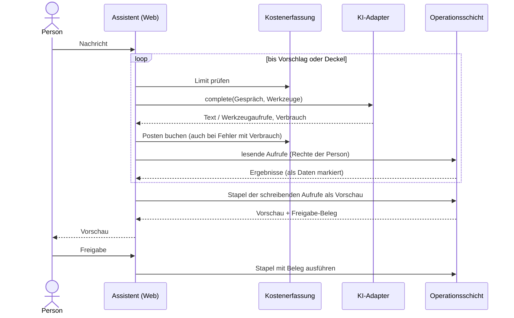

# E-009: KI-Anbindung, Anbieterneutralität, Limit, Analyse

Entscheidungsvorlage für [E-009](01-offene-entscheidungen.md). **Entschieden (PO 2026-11-23): Variante V2-G, nur Anbieter mit garantiertem EU-Datenstandort, siehe [ADR-006](ADR-006-ki-anbindung.md).** Grundlagen sind Rust ([ADR-004](ADR-004-sprache-und-laufzeit.md)) und die Operationsschicht nach [ADR-005](ADR-005-operationsschicht.md) (Werkzeuge aus den Operationen, Vorschau per Probelauf, Freigabe-Beleg, Stapel). Angaben zum Anbieter stammen aus der Claude-Dokumentation vom 2026-11-23; mit ▲ markierte Aussagen sind nicht geprüft. Kosten sind **Schätzungen** mit den genannten Annahmen.

## Frage

Wie spricht Chronos mit dem KI-Anbieter, wo läuft der Dialog des Assistenten, welches Modell wird genutzt, und wie werden Kosten, Limit und Datenschutz durchgesetzt, ohne dass ein Anbieterwechsel die Fachlogik berührt?

## Anforderungen

| Nr. | Anforderung | Quelle |
|---|---|---|
| B1 | Der Assistent kann jede Operation aufrufen; lesende ohne Freigabe, schreibende nur nach Vorschau und Freigabe | FA-015 AK 1 bis 3, ADR-005 |
| B2 | Rechte der angemeldeten Person; Verlauf „durch Assistent im Auftrag von …“ | FA-015 AK 4, 5 |
| B3 | Jede KI-Nutzung als Einzelposten (Person, sonst Team), auch berechnete Fehlversuche | FA-015 AK 6, FA-018, K-005 |
| B4 | Monatslimit je Team; Gesamtobergrenze 10 €/Monat für **alle** Zusatzkosten; bei Erreichen pausiert die KI, Betreiber wird benachrichtigt; geringfügiges Überschreiten im Einzelfall zulässig | F-015, RA-009, K-005 |
| B5 | Anbieterneutral, Start mit Claude; Anbieterwechsel ohne Änderung der Fachlogik; konkretes Modell in arc42 | F-015, Kapitel 4 Veränderlichkeit |
| B6 | Antworten in der Sprache der Person | FA-015 AK 7, RB-001 |
| B7 | Inhalte aus Terminen, Nachrichten und Gast-Namen sind nicht vertrauenswürdig und dürfen den Freigabezwang nicht umgehen | RA-010, K-006 |
| B8 | Personenbezogene Daten gehen unverändert an den Anbieter; Offenlegung in der Datenschutzerklärung (PO 2026-11-20); Details (AV-Vertrag, Datenumfang) offen | K-006, K-008, F-015 |
| B9 | Kostenverursachende Adapter nur über die Kostenerfassung; Operationen haben keine Adapter | K-005, ADR-005 |
| B10 | Prozesse: Web und Worker, keine dritte Laufzeitkomponente ohne Begründung | ADR-002, RB-003 |

## Befund

**Rust-Spike** (`src/ai/mod.rs`): `ai.ask` ist eine Operation, die die Messages-API über `reqwest` direkt aufruft (der Eigenbau umfasst ca. 26 Zeilen), mit den Werkzeugen aus der Operationsliste. Ein Aufruf, keine Schleife, kein Gesprächszustand; vorgeschlagene Aufrufe werden nicht ausgeführt. Kosten = Tokens aus der Antwort × konfigurierter Preis, ein Posten je Aufruf. Gesendet wird `anthropic-version: 2023-06-01`.

**Anbieter (Claude-Dokumentation, 2026-11-23):**
- Offizielle SDKs für Python, TypeScript, C#, Go, Java, PHP, Ruby, **nicht für Rust**.
- Aktuelle API-Version `2026-10-21`; sie entfernt unter anderem `temperature`, `top_p` und `top_k` (Senden ergibt 400).
- Preise je Million Tokens (USD): Haiku 5.5 Eingabe 0,10 / Ausgabe 0,50 (bis 100 000 Tokens Prompt); Sonnet 5.5 2 / 10; Opus 5.5 4 / 20. Cache-Lesen kostet 0,01 (Haiku), 0,10 (Sonnet), 0,20 (Opus); Cache-Schreiben (5 min) 0,125 / 2,50 / 5. Werkzeugnutzung kostet zusätzlich 286 Eingabetokens je Aufruf.
- **Kein Angebot für Verarbeitung nur in der EU:** Der Parameter `inference_geo` kennt nur `global` (Standard) und `us` (Aufpreis 1,1×).
- Aufbewahrung: Gesprächsinhalte werden laut der Seite zur Datenaufbewahrung standardmäßig nicht gespeichert, außer bei bestimmten „Covered Models“ (Fable 5, Mythos 5 und deren Folgeversionen; Haiku, Sonnet und Opus 5.5 gehören nicht dazu). Die allgemeine kommerzielle Richtlinie ist ausgelagert ▲. Zero Data Retention gibt es nur über den Vertrieb.
- **Folge für K-005:** Die Antwort enthält Tokenzahlen, aber keinen Preis. Der Betrag entsteht also immer aus einem Tarif im System (wie bei „Anbieter ohne Preis in der Antwort“).

## Teilentscheidungen

### T1 Client für den Anbieter

| Option | Vorteile | Nachteile |
|---|---|---|
| **T1-A** Eigener schmaler Client je Anbieter (`reqwest` + `serde`), wie Spike | Wenige Abhängigkeiten; volle Kontrolle über `usage`, Fehlercodes, Prompt-Caching und Kostenposten; nur die genutzten Felder | Pflege bei API-Versionen (Beispiel: der Spike sendet schon jetzt eine veraltete Version), Wiederholung bei 429/529 mit `retry-after` selbst bauen; geschätzt 300 bis 500 Zeilen statt 26 |
| **T1-B** Community-Crate (Anthropic-spezifisch oder Mehr-Anbieter-Bibliothek) | Weniger Eigencode; Mehr-Anbieter-Crates bringen Neutralität mit | Pflegestand unklar (Q-4 war bei Rust schon die Schwachstelle); Abstraktion kann `usage`, Cache-Tokens und Fehlversuche verdecken (B3); Lieferkette wächst |
| **T1-C** OpenAI-kompatible Schnittstelle als gemeinsamer Nenner | Ein Client für viele Anbieter | Anthropic beschreibt die Kompatibilität als Testhilfe mit Kernfunktionen; Prompt-Caching und Kostendetails fehlen dort ▲ |
| **T1-D** Sidecar mit offiziellem SDK (TypeScript oder Go) | Offizielles SDK | Dritte Laufzeitkomponente (B10), zweite Sprache im Betrieb |
| **T1-E** Vorhandenes LLM-Gateway (LiteLLM-Proxy des Betreibers); Chronos spricht nur das OpenAI-Format (`/chat/completions`) mit einem festen Modellnamen (Alias) | Modell und Anbieter zur Laufzeit wechselbar, ohne Code (Alias in der Datenbank des Proxys, Änderung über Admin-Oberfläche oder API ohne Neustart); ein einziger Client in Chronos; Kosten je Aufruf im Kopf `x-litellm-response-cost`, aufgeschlüsselt nach Eingabe, Ausgabe und Cache; echte Anbieterschlüssel bleiben im Proxy; harte Ausgabengrenze je Schlüssel als zweite Linie; EU-Plattformen (Bedrock, Vertex) sind Konfiguration statt Eigenbau; keine zusätzliche Ressource, weil der Proxy schon läuft | Neues Nachbarsystem, von dessen Verfügbarkeit der Assistent abhängt; Übersetzung der Werkzeugaufrufe auf Nicht-Anthropic-Modelle ist nicht belegt; Prompt-Caching wird unter der Mindestlänge des Anbieters ohne Fehler ausgelassen; ein Modellwechsel zur Laufzeit kann den Assistenten verschlechtern, ohne dass Chronos es merkt; der Proxy muss gepflegt und abgesichert werden (Version, kein öffentlicher Zugang) |

Belege zu T1-E: LiteLLM-Dokumentation (`docs.litellm.ai`, abgerufen 2026-11-23): Seiten zu Antwort-Kopfzeilen, Kostenerfassung, Modellverwaltung (`STORE_MODEL_IN_DB`), Prompt-Caching, virtuellen Schlüsseln (`max_budget`, `budget_duration`), Ausfallsicherheit (Fallbacks) und Protokollierung (Inhalte standardmäßig nicht gespeichert).

### T2 Grenze der Anbieterneutralität

| Option | Vorteile | Nachteile |
|---|---|---|
| **T2-A** Eigene schmale Schnittstelle `AiProvider`: Nachrichten, Werkzeugaufrufe, Werkzeugergebnisse, Abbruchgrund, Verbrauch (inkl. Cache-Tokens); je Anbieter ein Adapter | Fachlogik und Assistent kennen keinen Anbieter (B5); nur Funktionen, die Chronos nutzt; Test-Attrappe trivial | Das eigene Format muss Anbieterbesonderheiten (Caching, Abbruchgründe) neutral abbilden |
| **T2-B** Anthropic-Format als internes Format, andere Anbieter übersetzen darauf | Kein eigenes Format, der erste Adapter ist trivial | Neutralität nur auf dem Papier; der zweite Anbieter muss Anthropic-Eigenheiten nachbauen |
| **T2-C** Vorerst nur Claude, Schnittstelle erst beim zweiten Anbieter | Am wenigsten Arbeit jetzt | Widerspricht F-015 („anbieterneutrale Schnittstelle“) und B5 |

### T3 Dialog: wer führt die Schleife?

ADR-005 macht den Assistenten zum **Client** der Operationsschicht (Kapitel 5: Assistent → Operationsschicht, Assistent → KI-Anbieter). Er ist deshalb ein eigener Baustein und keine Operation wie `ai.ask` im Spike. Andernfalls hätte eine Operation einen Adapter, und das verbietet ADR-005.

| Option | Vorteile | Nachteile |
|---|---|---|
| **T3-A** Ein Aufruf ohne Schleife (wie Spike): Das Modell schlägt Aufrufe vor, der Client führt sie aus | Einfach, billig | Das Modell kann keine Daten nachschlagen („welche Termine liegen in den Herbstferien?“), bevor es vorschlägt; komplexe Aufgaben (F-015) scheitern oder raten |
| **T3-B** Schleife im Server: Das Modell ruft lesende Operationen direkt auf (mit den Rechten der Person), bekommt die Ergebnisse und schlägt am Ende schreibende Aufrufe vor. Der Server bildet daraus einen Stapel, erstellt per Probelauf die Vorschau, stellt den Freigabe-Beleg aus (ADR-005) und hält an. Nach der Freigabe führt er aus und lässt das Modell optional zusammenfassen | Erfüllt B1 vollständig; Freigabe ist serverseitig (B7); Kosten, Limit und Abbruch an einer Stelle; Grenzen (Runden, Tokens, Zeit) zentral | Eigenbau der Schleife (Runden, Abbruch, Fehlerfälle); längere Antwortzeiten |
| **T3-C** Schleife im Frontend: Der Client ruft abwechselnd KI-Endpunkt und Operationen auf | Server bleibt einfach | Logik in TypeScript verteilt; Freigabe und Limit schwerer durchzusetzen; mehr Umläufe über das Mobilnetz |

### T4 Prozess und Antwortweg

| Option | Vorteile | Nachteile |
|---|---|---|
| **T4-A** Im Web-Prozess, synchron (eine Anfrage pro Nutzernachricht, Zeitlimit z. B. 90 s) | Einfach; kein Zustand im Worker; passt zu ADR-002 | Lange offene Anfragen; bricht der Web-Prozess ab, ist der Schritt verloren (die Person sendet neu, ohne Schaden, da nichts ohne Freigabe geschrieben wird) |
| **T4-B** Web-Prozess mit Zwischenständen per Server-Sent Events | Bessere Rückmeldung auf dem Smartphone („suche Termine …“) | Streaming-Verarbeitung im eigenen Client und SSE zum Browser als zusätzlicher Eigenbau |
| **T4-C** Asynchron im Worker (Auftrag, Oberfläche fragt ab) | Robust gegen Neustarts; Web bleibt frei | Mehr Latenz und Zustand; Dialog wirkt träge; der Worker braucht die Operationsschicht samt Rechten |

### T5 Gesprächszustand

| Option | Vorteile | Nachteile |
|---|---|---|
| **T5-A** Zustandslos, der Client schickt den bisherigen Verlauf mit | Nichts gespeichert | Der Client könnte Werkzeugergebnisse fälschen (Angriffsweg für B7); Tokens wachsen unkontrolliert |
| **T5-B** Gespräch im Server (Tabelle), kurze Aufbewahrung (Vorschlag 24 h nach letzter Nachricht), Person kann es löschen | Werkzeugergebnisse stammen nachweislich vom Server; Kosten und Freigabe-Belege hängen an einem Gespräch; Verlauf kann gekürzt werden | Gesprächsinhalte sind personenbezogene Daten mit Löschfrist (K-008) |
| **T5-C** Kein Gespräch, jede Nachricht einzeln | Einfach, datensparsam | Rückfragen („nur die Gruppenstunden“) gehen nicht; die Bedienbarkeit leidet |

### T6 Kosten und Limit

| Option | Vorteile | Nachteile |
|---|---|---|
| **T6-A** Vorab prüfen, nachher buchen: vor jedem Aufruf Teamlimit und Gesamtgrenze prüfen; nach dem Aufruf Tokens × Tarif buchen (auch bei Fehlern mit `usage`); harte Deckel je Aufruf (`max_tokens`) und je Nachricht (Runden) | Einfach; passt zur PO-Entscheidung „geringfügiges Überschreiten zulässig“; der Deckel begrenzt das schlimmste Überschreiten | Gleichzeitige Dialoge können die Grenze gemeinsam leicht überschreiten |
| **T6-B** Reservieren: vor dem Aufruf den schlimmsten Fall reservieren, danach abrechnen | Grenze wird nie überschritten | Mehr Zustand; reservierte Beträge blockieren kleine Restbudgets |

Unabhängig davon: Tarif als Konfiguration mit Gültig-ab-Datum, Umrechnung in EUR beim Buchen (K-005); Ausgabenlimit in der Anthropic-Konsole als zweite Linie (wie im Spike-Proxy); **Prompt-Caching** für Systemtext und Werkzeugdefinitionen, weil sie bei jedem Aufruf gleich sind.

### T7 Modell

Schätzung je Assistenten-Aufgabe. **Annahmen:** 40 Operationen im Endausbau à 250 Tokens Schema (10 000 Tokens), Systemtext 1 000, Werkzeugzuschlag 286, dazu im Mittel 2 000 Tokens Gespräch und Ergebnisse je Aufruf, 400 Tokens Ausgabe je Aufruf, 4 Aufrufe je Aufgabe (2 nachschlagen, Stapel vorschlagen, zusammenfassen); mit Caching wird der Cache einmal je Aufgabe geschrieben.

| Modell | je Aufgabe ohne Caching | je Aufgabe mit Caching | Aufgaben je Monat bei rund 7 USD |
|---|---|---|---|
| Haiku 5.5 | ca. 0,006 USD | ca. 0,003 bis 0,004 USD | ca. 1 100 bis 2 000 |
| Sonnet 5.5 | ca. 0,12 USD | ca. 0,06 USD | ca. 55 bis 110 |
| Opus 5.5 | ca. 0,25 USD | ca. 0,13 USD | ca. 27 bis 55 |

Die 10 € gelten für **alle** Zusatzkosten (auch E-Mail, Backup); 7 USD für die KI sind eine Annahme, und der Wechselkurs ist offen. Bei Haiku 5.5 springen die Preise ab 100 000 Tokens Prompt auf das Fünffache, deshalb gehört eine Kürzung des Gesprächs zur Schleife.

| Option | Vorteile | Nachteile |
|---|---|---|
| **T7-A** Haiku 5.5 fest | Größte Reserve im Budget | Bei komplexen Aufgaben (RRULE, Stapel über viele Objekte) eher Fehlvorschläge; die Vorschau fängt Fehler ab, kostet aber Geduld |
| **T7-B** Sonnet 5.5 fest | Höhere Trefferquote bei komplexen Aufgaben ▲ | Budget reicht nur für wenige Dutzend Aufgaben im Monat |
| **T7-C** Modell als Konfiguration je Umgebung, Start mit Haiku 5.5; Wechsel nach einem Prüfkatalog typischer Aufgaben (erwartete Operationsaufrufe) | Entscheidung auf Messung statt Vermutung; Prüfkatalog dient zugleich als Regressionstest bei Modellwechsel | Prüfkatalog aufbauen und pflegen; Läufe kosten selbst Geld |
| **T7-D** Gestuft: Haiku, bei Bedarf (Abbruch, Rückfrage der Person) Sonnet | Gute Mischung aus Kosten und Qualität | Mehr Logik in der Schleife; Kosten schwer vorherzusagen |

### T8 Datenschutz und Datenstandort

| Option | Vorteile | Nachteile |
|---|---|---|
| **T8-A** Anthropic-API direkt (`global`), mit dem Auftragsverarbeitungsvertrag des Anbieters, Offenlegung in der Datenschutzerklärung | Einfach; beste Unterstützung für Caching und neue Modelle; passt zur PO-Entscheidung „Daten unverändert senden“ | Verarbeitung außerhalb der EU; rechtliche Bewertung der Übermittlung (Drittland) liegt beim Product Owner als Verantwortlichem |
| **T8-B** Claude über eine Cloud-Plattform mit EU-Region (z. B. Bedrock, Vertex) | Möglicherweise Verarbeitung in der EU ▲ (in der Dokumentation nicht bestätigt) | Zweites Cloud-Konto; Anmeldung (z. B. AWS-Signaturen) als Eigenbau oder großes SDK in Rust; Preisaufschlag für regionale Endpunkte (laut Preisseite 10 %); neue Modelle teils später |
| **T8-C** EU-Anbieter als Hauptanbieter (über T2-A) | EU-Verarbeitung | Werkzeugnutzung und Qualität ungeprüft; widerspricht „Start mit Claude“ |
| **T8-D** Daten vor dem Senden pseudonymisieren (Namen → IDs) | Weniger personenbezogene Daten beim Anbieter | Widerspricht PO-Entscheidung 2026-11-20 („unverändert senden“); Antworten mit Namen werden schwierig |

### Europäische Anbieter im Vergleich (Stand 2026-11-23)

Quellen: Preisseiten und Dokumentation der Anbieter (docs.mistral.ai Preise, Function Calling, Prompt-Caching, Regional Inference, Zero Data Retention; docs.ionos.com Preisliste gültig ab 29.10.2026, Modelle, Tool Calling, Data Handling; stackit.com Produktseite AI Model Serving; docs.litellm.ai Provider-Liste), abgerufen 2026-11-23. **Scaleway und OVHcloud** ließen sich nicht automatisch abrufen; beide unterstützt LiteLLM direkt, Preise und Bedingungen sind ungeprüft.

**Preise und Bedingungen** (je Million Tokens, Eingabe / Ausgabe):

| Anbieter, Modell | Preis | Caching | Werkzeugaufrufe | Datenstandort | Training, Aufbewahrung | LiteLLM |
|---|---|---|---|---|---|---|
| Anthropic Claude Haiku 5.5 (Vergleich) | 0,10 / 0,50 USD | ja (Lesen 0,01) | ja | `global` oder `us`, keine EU | Inhalte standardmäßig nicht gespeichert; ZDR über Vertrieb | ja |
| Anthropic Claude Sonnet 5.5 (Vergleich) | 2 / 10 USD | ja (Lesen 0,10) | ja | wie oben | wie oben | ja |
| **Mistral Small 4** | 0,15 / 0,60 USD | ja, gecachte Eingabe 10 %, automatisch | ja, auch parallel | EU-Endpunkt `api.eu.mistral.ai` mit 10 % Aufschlag; ohne ihn kein zugesicherter Standort; Verwaltungsdaten ggf. außerhalb | ZDR auf Antrag; Aufbewahrung und Training für die API nicht gefunden ▲; AV-Vertrag verlinkt, nicht gelesen ▲ | ja (`mistral/`) |
| **Mistral Large 4** | 0,70 / 2,10 USD | wie oben | ja | wie oben | wie oben | ja |
| **IONOS** gpt-oss-120b | 0,15 / 0,65 EUR netto | nicht dokumentiert | ja | nur Deutschland | Inhalte nicht gespeichert, kein Training, keine Unterauftragnehmer, AV-Vertrag Teil des Vertrags, BSI C5 | nur über `custom_openai/` (OpenAI-kompatibel) |
| **IONOS** Mistral Small 24B | 0,10 / 0,30 EUR netto | nicht dokumentiert | ungeprüft ▲ | wie oben | wie oben | wie oben |
| **IONOS** Qwen3.5-397B-A17B | 0,60 / 3,60 EUR netto | nicht dokumentiert | ja | wie oben | wie oben | wie oben |
| **STACKIT** gpt-oss-120b | 0,45 / 0,65 EUR | nicht gefunden | nicht gefunden ▲ | Europa (allgemeine Aussage, nicht für den Dienst) | „weder gespeichert noch zum Training verwendet“; AV-Vertrag nicht gefunden | nur wenn OpenAI-kompatibel ▲ |

**Kosten je Assistenten-Aufgabe** (gleiche Annahmen wie bei T7: 4 Aufrufe, 11 300 Tokens gleichbleibender Anteil, 2 000 Tokens Gespräch, 400 Tokens Ausgabe je Aufruf):

| Anbieter, Modell | je Aufgabe | Aufgaben bei 7 USD bzw. 7 EUR |
|---|---|---|
| Claude Haiku 5.5 | 0,003 bis 0,006 USD | ca. 1 100 bis 2 000 |
| Mistral Small 4, EU-Endpunkt | 0,005 USD (mit Caching) | ca. 1 450 |
| IONOS Mistral Small 24B | 0,006 EUR netto | ca. 1 200 |
| IONOS gpt-oss-120b | 0,009 EUR netto | ca. 780 |
| STACKIT gpt-oss-20b | 0,008 EUR | ca. 840 |
| Mistral Large 4, EU-Endpunkt | 0,021 USD (mit Caching) | ca. 330 |
| STACKIT gpt-oss-120b | 0,025 EUR | ca. 280 |
| IONOS Qwen3.5-397B-A17B | 0,038 EUR netto | ca. 185 |
| Claude Sonnet 5.5 | 0,06 bis 0,12 USD | ca. 55 bis 110 |

Hinweise: IONOS-Preise sind netto; ob Umsatzsteuer anfällt, hängt vom Vertragspartner ab (Privatperson, Verein, Unternehmen) und gilt ebenso für die übrigen Anbieter. Bei IONOS und STACKIT laufen offene Modelle (gpt-oss, Qwen, Llama, Mistral Small); wie gut sie Chronos-Aufgaben mit vielen Werkzeugen lösen, ist **ungeprüft**.

**Einschätzung:**
- **Mistral (EU-Endpunkt)** kommt Claude am nächsten. Werkzeugaufrufe sind dokumentiert, auch parallele; es gibt Caching, eine EU-Verarbeitung gegen 10 % Aufschlag und LiteLLM-Unterstützung. Small 4 liegt preislich bei Haiku 5.5, Large 4 deutlich unter Sonnet 5.5. Offen sind Aufbewahrung und Training ohne ZDR-Antrag.
- **IONOS** hat die klarsten Datenschutzaussagen: nur Deutschland, keine Speicherung, kein Training, keine Unterauftragnehmer, AV-Vertrag im Vertrag. Es bietet nur offene Modelle ohne dokumentiertes Caching, und die Anbindung an LiteLLM läuft über den generischen OpenAI-kompatiblen Weg.
- **STACKIT** ist nach den gefundenen Quellen nicht bewertbar (API-Kompatibilität, Werkzeugaufrufe, AV-Vertrag).
- **Folge für die Architektur:** Mit V2-G ist die Wahl des Anbieters eine Konfiguration im Gateway, keine Architekturentscheidung. Zu entscheiden bleibt, **welche Anbieter zulässig sind** (Datenstandort als Regel) und welches Modell nach dem Prüfkatalog Standard wird. Kandidaten für den ersten Prüflauf: Claude Haiku 5.5, Mistral Small 4 (EU), Mistral Large 4 (EU), IONOS gpt-oss-120b.

## Schutz gegen Prompt-Injection (in jeder Variante)

- Werkzeugergebnisse kommen nur aus dem Server (T5-B) und werden im Systemtext als **Daten** gekennzeichnet; Anweisungen darin gelten nicht.
- Schreiben ist nur über Stapel, Vorschau und Freigabe-Beleg möglich (ADR-005). Ein manipuliertes Modell kann vorschlagen, aber nichts ausführen.
- Lesende Aufrufe laufen mit den Rechten der Person: Das Modell sieht nichts, was die Person nicht sehen darf.
- Deckel für Runden, Tokens und Zeit je Nachricht (T6), damit eine Schleife aus manipulierten Inhalten nicht das Budget aufbraucht.
- Gäste haben keinen Zugang zum Assistenten (F-015: „nicht (?)“, hier als Annahme).

## Gesamtvarianten

| | V1 Schlank | V2 Assistent im Server | V3 EU zuerst |
|---|---|---|---|
| T1 Client | A eigener Client | A eigener Client | A eigener Client (je Plattform) |
| T2 Neutralität | B Anthropic-Format | **A eigene Schnittstelle** | A |
| T3 Schleife | A ohne Schleife | **B im Server** | B |
| T4 Prozess | A Web synchron | **A Web synchron**, B später | A |
| T5 Gespräch | C keins | **B im Server, 24 h** | B |
| T6 Limit | A | **A + Deckel + Caching** | A + Deckel |
| T7 Modell | A Haiku | **C konfigurierbar, Start Haiku, Prüfkatalog** | C |
| T8 Datenstandort | A Anthropic | **A Anthropic** | B oder C |

| Kriterium (ADR-001-Rang) | V1 | V2 | V3 |
|---|---|---|---|
| Änderbarkeit: Anbieterwechsel ohne Fachlogik (1) | o | ++ | ++ |
| Bedienbarkeit: komplexe Aufgaben im Dialog (2) | - | ++ | + |
| Ressourcen und Kosten (3) | ++ | + | o (Aufschlag, zweites Konto) |
| Sicherheit, RA-010 | o | ++ | ++ |
| Datenschutz: Verarbeitung in der EU | - | - | + ▲ |
| Eigenbau | + (klein) | o (Client, Schleife, Gespräch) | - (zusätzlich Cloud-Anmeldung) |

### Variante V2-G: V2 über das LiteLLM-Gateway

Wie V2, aber T1-E statt T1-A. Was sich ändert:

| Teilfrage | V2 (direkt) | V2-G (Gateway) |
|---|---|---|
| T1 Client | Anthropic-Format, eigener Client | OpenAI-Format gegen LiteLLM, eigener schmaler Client (`reqwest`, weil Chronos die Kopfzeilen lesen muss) |
| T2 Neutralität | `AiProvider` mit Adapter je Anbieter | `AiProvider` bleibt, mit **einem** Adapter „OpenAI-kompatibel“; die Übersetzung je Anbieter liegt im Gateway |
| T6 Kosten | Tokens × Tarif aus der Chronos-Konfiguration | Betrag aus `x-litellm-response-cost` (passt zu K-005 „Preis aus der Antwort“), in EUR umgerechnet; Tarif nur als Rückfall, falls der Kopf fehlt. Teamlimit und Einzelposten bleiben in Chronos; Ausgabengrenze am virtuellen Schlüssel ersetzt das Konsolenlimit |
| T7 Modell | Modell-ID in der Konfiguration, Anbieterwechsel braucht Code | Chronos ruft `chronos-assistant` (je Umgebung eigener Schlüssel und Alias); Modell und Anbieter wechseln im Gateway. Der Posten speichert das tatsächlich genutzte Modell (`x-litellm-model-id`) |
| T8 Datenstandort | Anthropic `global` | Wie V2, aber Bedrock oder Vertex in einer EU-Region später nur Konfiguration im Gateway (V3 ohne Code) |

**Bedingungen für V2-G:**
1. **Modellwechsel nur nach Prüfkatalog**, zuerst in staging. Der Alias macht den Wechsel leicht, der Katalog stellt sicher, dass Werkzeugaufrufe mit dem neuen Modell weiter funktionieren.
2. **Fallbacks aus**, oder nur auf ausdrücklich gleichwertige Ziele. Ein stiller Wechsel auf einen anderen Anbieter ändert Datenstandort und Kosten.
3. **Keine Inhalte im Gateway speichern:** `store_prompts_in_spend_logs` aus (Standard, auch den Schalter in der Oberfläche prüfen), keine Protokoll-Callbacks an Dritte. Sonst entsteht eine zweite Kopie der Gespräche außerhalb der Löschfrist (T5-B).
4. **Eigener virtueller Schlüssel je Umgebung** mit Zugriff nur auf den eigenen Alias und einer Ausgabengrenze unterhalb der Gesamtgrenze.
5. **Gateway nicht öffentlich erreichbar**, Version aktuell halten. Der Proxy hält die echten Anbieterschlüssel.
6. Fällt das Gateway aus, pausiert der Assistent wie beim Erreichen des Limits. Die Fachfunktionen sind nicht betroffen.

**Einschätzung:** V2 erfüllt F-015 („komplexe Aufgaben im Dialog“) erst mit der Schleife im Server und nutzt die Bausteine aus ADR-005 (Stapel, Probelauf, Beleg) unverändert. Die eigene Schnittstelle hält V3 offen: Ein EU-Anbieter oder eine EU-Plattform ist später ein weiterer Adapter. Der Datenstandort ist die einzige Frage, bei der V2 schlechter abschneidet, und sie ist rechtlicher Natur. **V2-G** verschiebt den Anbieterwechsel vom Code in die Gateway-Konfiguration. Das erfüllt den Wunsch des Product Owners nach Wechsel zur Laufzeit und senkt den Eigenbau (ein Adapter statt einer je Anbieter). Bezahlt wird mit einem zusätzlichen Nachbarsystem; das ist vertretbar, weil das Gateway schon läuft und sein Ausfall nur den Assistenten betrifft.

### Skizze V2 (Rust, nicht übersetzt)

```rust
/// Anbieterneutral (T2-A); je Anbieter ein Adapter. Kennt keine Operationen.
pub trait AiProvider: Send + Sync {
    async fn complete(&self, req: AiRequest) -> Result<AiResponse, AiError>;
}
pub struct AiRequest  { pub system: String, pub messages: Vec<Msg>, pub tools: Vec<ToolDef>, pub max_tokens: u32, pub cache_prefix: bool }
pub struct AiResponse { pub content: Vec<Block>, pub stop: StopReason, pub usage: Usage }
pub struct Usage      { pub input: u32, pub output: u32, pub cache_write: u32, pub cache_read: u32 }
pub enum   Block      { Text(String), ToolCall { id: String, name: String, input: Value } }
```



## Fragen an den Product Owner

1. Gilt V2 mit Anthropic direkt (T8-A), oder ist Verarbeitung in der EU eine Bedingung (V3)? Mit V2-G heißt das konkret: Welche Anbieter dürfen im Gateway hinter `chronos-assistant` stehen (nur EU, z. B. Mistral EU oder IONOS, oder auch Anthropic `global`)? Die rechtliche Bewertung der Übermittlung liegt bei dir als Verantwortlichem.
2. Welcher Anteil der 10 €/Monat steht der KI zu, und wie hoch ist das Monatslimit je Team?
3. Startmodell Haiku 5.5 mit Prüfkatalog (T7-C) einverstanden?
4. Aufbewahrung der Gespräche: 24 h nach der letzten Nachricht?
5. Bleibt der Assistent für Gäste gesperrt?
6. V2-G: Wo läuft das LiteLLM-Gateway (im selben Cluster? in der EU?), wer betreibt es, welche Version läuft, und sind Modelle in der Datenbank gespeichert (`STORE_MODEL_IN_DB`)? Wird es von anderen Anwendungen mitgenutzt?

## Nächster Schritt (Vorschlag)

Nach der Entscheidung: ADR-006 schreiben; als erste Umsetzung den Adapter für Anthropic mit API-Version `2026-10-21` und die Schleife gegen eine Attrappe bauen. Danach einen Prüfkatalog von 10 bis 20 typischen Aufgaben aus F-015 (Serie mit komplexer Regel, Team-Struktur, Absage im Zeitraum) gegen Haiku 5.5 und Sonnet 5.5 laufen lassen und Trefferquote, Tokens und Kosten je Aufgabe messen.
