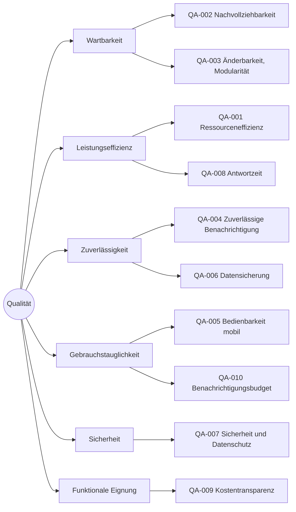

# 10.1 Qualitätsbaum

Das Gewicht der Zweige legt [ADR-001](../09-entscheidungen/ADR-001-prioritaet-der-qualitaetsziele.md) fest. Qualitätsziele auf oberster Ebene: [1.2](../01-einfuehrung/02-qualitaetsziele.md).
