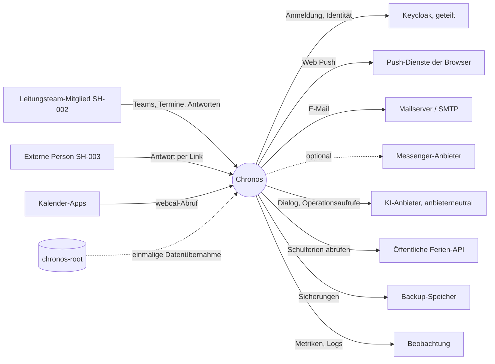

# SC-001: Systemkontext, Akteure und Nachbarsysteme

Chronos umfasst die Web-Anwendung und alles, was sie zum Betrieb braucht (Server, Datenhaltung, Hintergrundverarbeitung). Alles andere ist Umgebung.

| Nachbar | Art | Rolle | Ausgetauschte Information |
|---|---|---|---|
| Leitungsteam-Mitglieder | Mensch | Hauptnutzer, per Smartphone und Browser | Teams, Termine, Rückmeldungen, Labels, Nachrichten |
| Externe Personen | Mensch | Antworten über Einladungslink ohne Konto | Name, Antwort |
| Keycloak | System, geteilt | Einzige Quelle für Identität und Anmeldung ([RB-002](../07-randbedingungen/RB-002-identitaetsdienst-keycloak.md)) | Anmeldung, Kennung, Anzeigename, E-Mail |
| Push-Dienste | System | Zustellung von Web Push | verschlüsselte Nutzlast |
| Mailserver | System | E-Mail-Benachrichtigung; eigener SMTP-Relay bzw. EU-Anbieter | Nachrichten |
| Messenger-Anbieter | System, optional | Telegram/WhatsApp; nur Option ([F-008](../04-product-backlog/features/F-008-benachrichtigungen.md)) | Nachrichten |
| KI-Anbieter | System | Dialog und Operationsaufrufe des Assistenten ([F-015](../04-product-backlog/features/F-015-ki-assistent.md)); anbieterneutral, Start mit Claude; erhält personenbezogene Daten ([RA-010](../12-risiken-annahmen/RA-010-ki-assistent-risiken.md)) | Gesprächsinhalte, Operationsaufrufe |
| Ferien-API | System, öffentlich | Schulferienzeiträume für Serien ([F-014](../04-product-backlog/features/F-014-serientermine.md)); Antworten werden zwischengespeichert | Ferienzeiträume |
| Kalender-Apps | System | Abruf des persönlichen Feeds ([F-009](../04-product-backlog/features/F-009-kalender-feed.md)) | iCalendar-Daten |
| Backup-Speicher | System | Datensicherung ([QA-006](../06-qualitaet/QA-006-datensicherung.md)); S3-kompatibler EU-Objektspeicher, täglich, clientseitig verschlüsselt | Datenbankabzüge |
| Beobachtung | System | Metriken und Logs ([QA-002](../06-qualitaet/QA-002-nachvollziehbarkeit.md)) | Metriken, Logs |
| chronos-root | Altsystem | Quelle der einmaligen Datenübernahme ([F-012](../04-product-backlog/features/F-012-datenuebernahme.md)) | Bestandsdaten |
