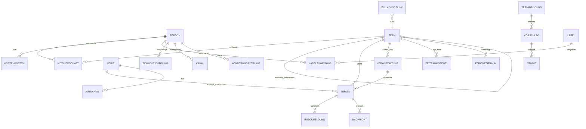

# M-001: Fachdatenmodell

| Begriff | Eigenschaften |
|---|---|
| Person | Konto-Person (Keycloak-Kennung) **oder** Gast-Person (Name, aus Einladungslink, ohne Konto) |
| Team | Name, optional übergeordnetes Team (Baum, beliebige Tiefe) |
| Mitgliedschaft | Person in Team; alle Mitglieder gleichberechtigt; Mitgliedschaft erbt nach oben ([M-002](M-002-berechtigungen.md)) |
| Veranstaltung | Titel, Beschreibung, Zeitraum; gehört einem Team |
| Termin | Team, optional Veranstaltung, Art (Treffen \| Frist/Marke), Titel, Ort, Beginn, Ende, Status ([M-003](M-003-zustaende.md)) |
| Rückmeldung | Person zu Termin: offen \| zugesagt \| abgesagt \| zeitweise, ggf. Hinweis |
| Terminfindung / Vorschlag / Stimme | Vorschläge mit Zeitraum, Stimmen je Person |
| Label / Labelzuweisung | Freitext; Person trägt Label für genau einen Bereich (Team, Veranstaltung oder Termin) |
| Einladungslink | Token, Ziel (Team, Termin, Terminfindung), Widerruf, Ablauf (Gastlink: Terminende + 30 Tage) |
| Nachricht | Text, Autor, Zeitpunkt, System- oder Nutzernachricht |
| Kanal / Einstellung | Kanal je Person (Web Push, E-Mail, optional Messenger) und Einstellungen je Ereignisart |
| Serie | RRULE (RFC 5545), Beginn, Team, Ausnahmen (einzelne Vorkommen, Ferienzeiträume); Vorkommen sind Termine mit Rückmeldung je Vorkommen |
| Ferienzeitraum | Team, Name, Von, Bis; Ausnahme für Serien |
| Zeitraumsregel | Team, Zeitraum, Aktion (absagen); wirkt auf bestehende und später angelegte Termine ([F-016](https://github.com/LetsFinishSchool/chronos-v3/issues/88)) |
| Kostenposten | Benutzer oder Team, Auslöser, Anbieter, Zeitpunkt, Menge, Betrag ([RB-010](../07-randbedingungen/RB-010-kostenzuordnung.md)) |
| Änderungsverlauf | Akteur (Person oder Assistent im Auftrag einer Person), Aktion, Vorher-Zustand zur Wiederherstellung, Zeitpunkt, Bündel-ID; für Teams, Mitgliedschaften, Termine, Veranstaltungen |
| Benachrichtigung | Ereignis, **Auslöser**, Empfänger, Kanal, Ergebnis, Zeitpunkt ([QA-002](../06-qualitaet/QA-002-nachvollziehbarkeit.md)) |

Begriffe: [Glossar](../08-terminologie/glossar.md). Migration: [M-005](M-005-migrationsabbildung.md).
