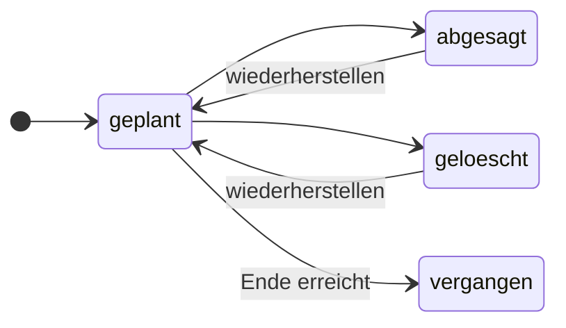
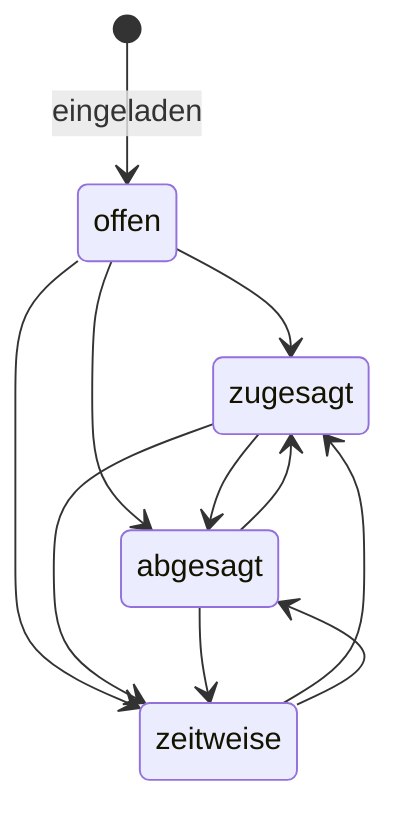
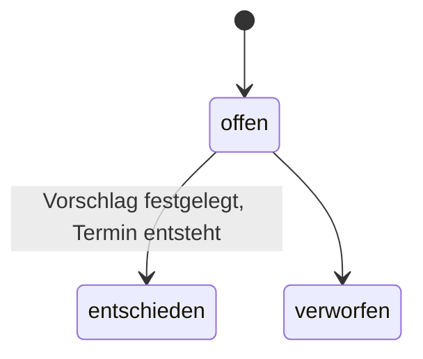

# M-003: Zustände von Termin, Rückmeldung und Terminfindung

- Nur die betroffene Person ändert ihre Rückmeldung, bis zum Terminbeginn; „offen“ kann nicht wieder gesetzt werden.
- Termine der Art Frist/Marke haben keine Rückmeldung.
- Es gibt keinen von der Teilnehmerzahl abgeleiteten Terminstatus (Mindestteilnehmerzahl entfällt, [F-003](../04-product-backlog/features/F-003-termine.md)).
